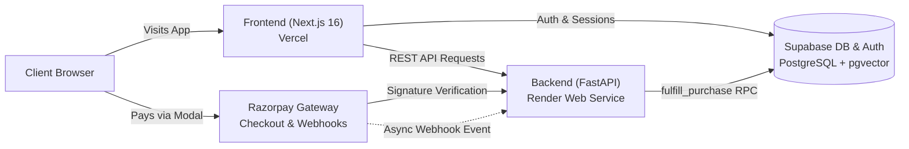

# TraceClause AI v2 — Production Deployment & Razorpay Integration Guide

This guide provides the complete, step-by-step roadmap to configure Razorpay payments, deploy the frontend to **Vercel**, deploy the backend to **Render**, connect both services, and verify the entire payment-to-entitlement pipeline.

---

## Architecture Overview



| Component | Technology | Recommended Host | Why |
| :--- | :--- | :--- | :--- |
| **Frontend** | Next.js 16 (App Router), React 19, Tailwind CSS | **Vercel** | Native Next.js platform, Turbopack builds, global edge CDN, zero-config SSR. |
| **Backend** | FastAPI (Python 3.12), LangChain, PyMuPDF | **Render** | Native Python container hosting, handles CPU-intensive PDF parsing, persistent workers. |
| **Database & Auth** | PostgreSQL 15, pgvector, Supabase Auth | **Supabase Cloud** | Managed database, RLS security, stored procedures, built-in vector search. |
| **Payments** | Razorpay Standard Checkout & Webhooks | **Razorpay** | UPI, Credit/Debit cards, Netbanking, International cards. |

---

## Part 1: Razorpay Setup & Credentials

You need **three credentials** from Razorpay:
1. `RAZORPAY_KEY_ID` (Public identifier, used by frontend modal & backend API)
2. `RAZORPAY_KEY_SECRET` (Private secret, used by backend to sign orders & verify checkout)
3. `RAZORPAY_WEBHOOK_SECRET` (Shared secret string, used by backend to authenticate asynchronous webhooks)

---

### Step 1.1: Create & Access Razorpay Account
1. Go to [https://dashboard.razorpay.com](https://dashboard.razorpay.com) and sign up or log in.
2. Complete initial email verification and business details.
3. In the top navbar or left sidebar, notice the toggle: **Test Mode** vs **Live Mode**.
   > **Tip**: Always start in **Test Mode**. Test Mode allows you to generate mock payments, test card declines, and test webhooks without real money or business KYC approval.

---

### Step 1.2: Generate API Key ID & Key Secret
1. In the left navigation menu, click **Account & Settings** (or the gear icon).
2. Under the **API Keys & Plugins** section, select **API Keys**.
3. Click the blue **Generate Key** (or **Generate Test Key**) button.
4. A popup will appear displaying:
   - **Key ID**: Starts with `rzp_test_...` (in test mode) or `rzp_live_...` (in live mode).
   - **Key Secret**: A 24-character random string (e.g. `w8K2x9...`).
5. **Download the Key Details file** or copy both strings immediately.
   > **Warning**: The `Key Secret` is displayed **only once**. If you navigate away without copying it, you will need to revoke it and generate a new key pair.

---

### Step 1.3: Configure Webhook & Webhook Secret
The webhook allows Razorpay to notify your backend asynchronously when a payment succeeds, ensuring users receive their subscription even if their browser crashes or closes during checkout.

1. In Razorpay Dashboard, go to **Account & Settings** -> **Webhooks** (under Developer Controls).
2. Click **+ Add New Webhook**.
3. Fill in the fields:
   - **Webhook URL**:
     - *For Production (Render)*: `https://<your-render-service-name>.onrender.com/api/v1/payments/razorpay/webhook`
     - *For Local Testing*: You can use an ngrok URL e.g. `https://xxxx.ngrok-free.app/api/v1/payments/razorpay/webhook`
   - **Secret**: Create your own custom random alphanumeric string (32 characters recommended).
     - *Example command to generate one*: `openssl rand -hex 16`
     - Copy this exact secret — this is your `RAZORPAY_WEBHOOK_SECRET`.
   - **Alert Email**: Enter your developer email to receive failure notifications.
   - **Active Events**: Check the following checkboxes:
     - `payment.captured` *(Crucial: triggers immediate subscription fulfillment)*
     - `order.paid` *(Crucial: secondary trigger for order completion)*
     - `payment.failed` *(Optional: logs failed transactions)*
4. Click **Create Webhook**.

---

### Step 1.4: Razorpay Test Cards & Verification
When testing in **Test Mode**, use these details in the checkout modal:

| Field | Test Value |
| :--- | :--- |
| **Card Number** | `4111 1111 1111 1111` (Visa) or `5123 4567 8901 2346` (Mastercard) |
| **Expiry Date** | Any future date (e.g., `12/28`) |
| **CVV** | `123` |
| **OTP** | Any 4 or 6 digit number (e.g., `123456`) or click "Success" on Razorpay emulator |
| **UPI VPA** | `success@razorpay` |

---

## Part 2: Backend Deployment on Render

The backend is a high-performance Python FastAPI service requiring PyMuPDF and LangChain.

### Step 2.1: Create Render Web Service
1. Log in to [Render Dashboard](https://dashboard.render.com).
2. Click **New +** in the top bar and select **Web Service**.
3. Select **Build and deploy from a Git repository** and connect your GitHub repository.
4. Configure the service settings:
   - **Name**: `traceclause-backend` (or your preferred name)
   - **Region**: Choose a region closest to your users (e.g., *Singapore*, *Frankfurt*, or *Oregon*).
   - **Branch**: `main`
   - **Root Directory**: `backend` *(Important: set this to backend so Render runs inside the Python folder)*
   - **Runtime**: `Python 3`
   - **Build Command**:
     ```bash
     pip install --upgrade pip && pip install -r requirements.txt
     ```
   - **Start Command**:
     ```bash
     uvicorn app.main:app --host 0.0.0.0 --port $PORT
     ```
   - **Instance Type**:
     - *Starter* ($7/mo) is recommended because PDF processing and document vectorization require dedicated RAM (512MB-1GB). Free tier can work for basic testing but may sleep after 15 minutes of inactivity.

---

### Step 2.2: Add Environment Variables in Render
In the Render Web Service settings, navigate to the **Environment** tab and add the following key-value pairs:

| Variable Name | Example Value / Instructions |
| :--- | :--- |
| `ENVIRONMENT` | `production` |
| `PROJECT_NAME` | `TraceClause AI` |
| `VERSION` | `2.0.0` |
| `API_V1_STR` | `/api/v1` |
| `ALLOW_DEMO_AUTH` | `false` |
| `SECRET_KEY` | *Generate a 64-char string via `openssl rand -hex 32`* |
| `ALLOWED_ORIGINS` | `https://<your-vercel-domain>.vercel.app,http://localhost:3000` |
| `SUPABASE_URL` | `https://<your-project-id>.supabase.co` |
| `SUPABASE_PUBLISHABLE_KEY` | `sb_publishable_...` *(From Supabase Project Settings -> API)* |
| `SUPABASE_SECRET_KEY` | `sb_secret_...` *(Supabase service_role key with bypass RLS rights)* |
| `SUPABASE_JWKS_URL` | `https://<your-project-id>.supabase.co/auth/v1/.well-known/jwks.json` |
| `GEMINI_API_KEY` | *Your Google AI Studio Gemini API Key* |
| `OPENAI_API_KEY` | *(Optional if Gemini is provided, or your OpenAI key)* |
| `ANTHROPIC_API_KEY` | *(Optional if Gemini/OpenAI is provided)* |
| `RAZORPAY_KEY_ID` | `rzp_test_...` (or `rzp_live_...`) |
| `RAZORPAY_KEY_SECRET` | *Secret copied in Step 1.2* |
| `RAZORPAY_WEBHOOK_SECRET` | *Secret string created in Step 1.3* |

5. Click **Create Web Service** (or **Save Changes**).
6. Render will build and deploy. Once finished, copy your service URL:
   `https://traceclause-backend.onrender.com`

---

## Part 3: Frontend Deployment on Vercel

The frontend is built with Next.js 16 and communicates with Render and Supabase.

### Step 3.1: Import Project to Vercel
1. Log in to [Vercel Dashboard](https://vercel.com).
2. Click **Add New...** -> **Project**.
3. Import your GitHub repository (`ScanShield_AI_v2`).
4. Configure Project:
   - **Framework Preset**: `Next.js` (auto-detected).
   - **Root Directory**: Click **Edit** and choose `frontend`.
   - **Build Command**: `next build` (default).
   - **Output Directory**: `.next` (default).

---

### Step 3.2: Add Environment Variables in Vercel
Expand the **Environment Variables** section and configure:

| Variable Name | Value | Purpose |
| :--- | :--- | :--- |
| `NEXT_PUBLIC_API_URL` | `https://traceclause-backend.onrender.com/api/v1` | Points frontend API calls to Render backend |
| `NEXT_PUBLIC_SUPABASE_URL` | `https://<your-project-id>.supabase.co` | Supabase Authentication client URL |
| `NEXT_PUBLIC_SUPABASE_ANON_KEY` | `sb_publishable_...` (or anon key) | Supabase public client authorization |
| `NEXT_PUBLIC_RAZORPAY_KEY_ID` | `rzp_test_...` (or `rzp_live_...`) | Public Razorpay key to open checkout modal |

5. Click **Deploy**.
6. When deployment finishes, Vercel will give you a live production URL:
   `https://traceclause.vercel.app` (or your assigned domain).

---

## Part 4: Connecting All Services

Now you must ensure all components trust each other across domains.

### Step 4.1: Update Render CORS with Vercel Domain
1. In [Render Dashboard](https://dashboard.render.com), open your backend Web Service.
2. Go to **Environment**.
3. Update `ALLOWED_ORIGINS` to include your new Vercel domain:
   ```env
   ALLOWED_ORIGINS=https://traceclause.vercel.app,http://localhost:3000
   ```
4. Save Changes (Render will trigger a quick zero-downtime redeploy).

---

### Step 4.2: Update Supabase Auth Redirects
1. Go to your [Supabase Dashboard](https://supabase.com/dashboard).
2. Navigate to **Authentication** -> **URL Configuration**.
3. Set **Site URL** to your Vercel URL:
   ```
   https://traceclause.vercel.app
   ```
4. Under **Redirect URLs**, add:
   ```
   https://traceclause.vercel.app/**
   http://localhost:3000/**
   ```
5. Click **Save**.

---

### Step 4.3: Verify Supabase Schema Hardening
Ensure the master migration script has been executed in the Supabase SQL Editor:
1. Open [`20261105_production_master_hardening.sql`](file:///home/karan-singh/Downloads/Personal%20Files/aicodewithkaran/ScanShield_AI_v2/supabase/migrations/20261105_production_master_hardening.sql).
2. Copy the entire file content.
3. Paste into **Supabase Dashboard** -> **SQL Editor** -> **New Query** -> **Run**.
4. Confirm success (Creates `purchases`, `processed_webhooks`, RLS policies, trigger protections, and the atomic `fulfill_purchase` stored procedure).

---

### Step 4.4: Confirm Razorpay Webhook URL
1. In Razorpay Dashboard -> **Account & Settings** -> **Webhooks**.
2. Verify the Webhook URL points to your Render backend:
   ```
   https://traceclause-backend.onrender.com/api/v1/payments/razorpay/webhook
   ```
3. Test the webhook using Razorpay's **Send Test Webhook** button:
   - Event: `payment.captured`
   - Check response: Expect HTTP `200 OK`.

---

## Part 5: End-to-End Verification Checklist

Run this quick test to confirm your live setup is working:

1. **Sign Up / Log In**:
   - Open your Vercel app in an incognito window.
   - Sign up with a test email. Confirm that you land on the dashboard with `Free Tier` badge.
2. **Contract Upload**:
   - Upload a sample PDF or DOCX contract.
   - Confirm contract is parsed, risks are scored, and breakdown tabs render.
3. **TraceClause AI Assistant Gating**:
   - Click the **RAG Assistant** tab.
   - Confirm it displays the **Locked (Solo & Team)** view with the *"Upgrade Plan to Unlock Assistant"* CTA.
4. **Checkout Modal Execution**:
   - Click *"Upgrade Plan to Unlock Assistant"*.
   - In the modal, select **Solo Plan** ($79/mo) or **Team Plan** ($299/mo).
   - Confirm the official Razorpay Checkout popup loads with the brand title and amount.
5. **Simulate Payment**:
   - Enter Razorpay test card `4111 1111 1111 1111`, expiry `12/28`, CVV `123`.
   - Submit OTP and approve payment.
6. **Automatic Entitlement Unlock**:
   - Confirm the modal closes, your subscription tier updates to `Solo` or `Team`, and the **TraceClause AI Assistant** unlocks immediately!
7. **Ask Question**:
   - Type `"What are the key liability clauses in this agreement?"`.
   - Confirm you receive answers with verifiable clause citations.

---

## Switching to Live Mode (Real Money)

When ready to accept real payments:
1. Complete Razorpay Account Activation & KYC in the Razorpay Dashboard.
2. Toggle the dashboard switch from **Test Mode** to **Live Mode**.
3. Generate **Live API Keys** (`rzp_live_...`).
4. Update `RAZORPAY_KEY_ID` and `RAZORPAY_KEY_SECRET` in Render.
5. Update `NEXT_PUBLIC_RAZORPAY_KEY_ID` in Vercel.
6. Create a new Live Webhook in Razorpay with the live `RAZORPAY_WEBHOOK_SECRET` and your Render URL.
7. Trigger a $1 live test transaction with your personal card or UPI to confirm real fund capture.

