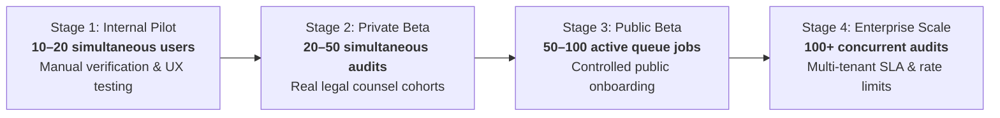

# 🚀 TraceClause AI — Production Go-Live & Enterprise Scale Hardening Plan (v2.1)
**Classification:** Enterprise Engineering Roadmap, Launch Gates & Hardening Blueprint  
**Review Status:** Incorporates Full Copilot AI Peer Review & Mandatory Launch Gate Policies  
**Target Goal:** Support 100s–1,000s of monthly active users with deterministic fault isolation, zero event-loop freezes, zero data corruption, zero fake/mock legal output, and safe staged concurrency.  
**Target Stack:** Next.js 16 (React 19, Vercel) / FastAPI 0.115 (Python 3.12, Render/Docker) / Supabase pgvector / Razorpay  

---

## 1. Mandatory Launch Gate Policy

> [!CAUTION]
> **Recommended Launch Gate: DO NOT launch open public registration after implementing features alone.**
> Feature completion does not equal operational readiness. Public traffic must remain gated until every item in the **Minimum Launch Acceptance Criteria** passes formal verification.

### Staged Performance & Concurrency Targets

Concurrency targets must be scaled and measured in stages—not jumped to 100 simultaneous LLM calls on day one:



* **Architectural Definition of 100 Concurrency:** The target is **100 concurrent active/queued jobs**, *not* 100 unthrottled simultaneous HTTP calls to OpenAI/Gemini. The worker queue throttles and batches upstream LLM execution so provider TPM/RPM rate limits are respected.
* **Definition of a 100-User Test Pass:** A successful test run means **zero unexpected 500 Internal Server Errors or 504 Gateway Timeouts**. Provider rate limits (429) or transient provider outages must be handled explicitly with retries or clean failure/refund states—not treated as uncaught crashes.

---

## 2. Minimum Launch Acceptance Criteria Checklist

Before moving from Private Beta to Public Launch, all 10 gates must be formally certified:

- [ ] **Gate 1: Zero Mock Data in Production.** No mock analysis is ever returned to a real user under any circumstance (including upstream 429s, API outages, or malformed JSON responses). If AI analysis fails after retries, the audit is marked failed and quota is preserved.
- [ ] **Gate 2: Zero Uncaught Browser Storage Failures.** `sessionStorage` 5MB quota crashes are eliminated. Full text and clauses are managed in React memory state and fetched on demand by report ID.
- [ ] **Gate 3: Zero Orphaned Jobs on Restart.** Redeploying or restarting web or worker processes does not leave jobs permanently stuck in `processing`. The heartbeat janitor reclaims orphaned jobs.
- [ ] **Gate 4: Idempotent Job Retries.** Retrying an interrupted or failed job never creates duplicate `contract_reports` or duplicate rows in `contract_embeddings`.
- [ ] **Gate 5: Automated Quota Refunds on Failure.** Every failed, cancelled, or aborted audit automatically releases or refunds the reserved quota in `public.quota_reservations`.
- [ ] **Gate 6: Actionable User Failure Messaging.** Failed provider calls produce a clean, actionable status message in the UI (e.g., *"Upstream AI provider busy. Your quota has been restored. Click to retry."*), never a raw stack trace or hanging spinner.
- [ ] **Gate 7: Complete Tenant Isolation Across All Endpoints.** Pytest suite verifies that User A cannot read, query, poll, export, or delete User B's jobs, reports, embeddings, or workspaces.
- [ ] **Gate 8: Realistic Workload Load Testing.** Automated load tests execute using real 15-, 30-, and 50-page contracts with 100 simultaneous jobs, measuring latency, memory, and queue wait times.
- [ ] **Gate 9: Four-Tier Telemetry.** Provider latency/errors, database connection metrics, queue depth/wait times, and frontend error boundaries each expose observable metrics.
- [ ] **Gate 10: Event Loop Free of Blocking Work.** All CPU-bound parsing (`fitz` / `docx`) and synchronous provider calls are isolated to worker threads (`asyncio.to_thread`).

---

## 3. Detailed Technical Implementation Workstreams

### PHASE 1: Zero-Freeze & Trust Integrity (Days 1–2)
*Mandatory Before Inviting Pilot Users*

#### Task 1.1: Event-Loop Unblocking
- In [`backend/app/api/v1/endpoints/upload.py`](file:///home/karan-singh/Downloads/Personal%20Files/aicodewithkaran/ScanShield_AI_v2/backend/app/api/v1/endpoints/upload.py):
  ```python
  extracted_text = await asyncio.to_thread(DocumentParser.parse_document, file_bytes, filename)
  clauses = await asyncio.to_thread(ChunkingEngine.split_into_clauses, extracted_text)
  ```
- In [`backend/app/api/v1/endpoints/analysis.py`](file:///home/karan-singh/Downloads/Personal%20Files/aicodewithkaran/ScanShield_AI_v2/backend/app/api/v1/endpoints/analysis.py):
  ```python
  result = await asyncio.to_thread(analyzer.analyze_clauses, file_name, extracted_text, clauses)
  ```

#### Task 1.2: Eliminate Silent Mock Fallbacks in Production
- In [`backend/app/services/llm_analyzer.py`](file:///home/karan-singh/Downloads/Personal%20Files/aicodewithkaran/ScanShield_AI_v2/backend/app/services/llm_analyzer.py):
  - Strictly gate `_mock_analysis` behind `settings.ENVIRONMENT in ("development", "test") and settings.ALLOW_DEMO_AUTH`.
  - In production, when retries are exhausted, raise an explicit exception and fail the job cleanly.
  - Automatically invoke `QuotaService.release_quota` so users are never charged for incomplete audits.

#### Task 1.3: Wire Frontend `Dropzone.tsx` to the Durable Queue
- In [`frontend/src/lib/api-client.ts`](file:///home/karan-singh/Downloads/Personal%20Files/aicodewithkaran/ScanShield_AI_v2/frontend/src/lib/api-client.ts), implement `submitJob` and `pollJobStatus`.
- In [`frontend/src/components/upload/Dropzone.tsx`](file:///home/karan-singh/Downloads/Personal%20Files/aicodewithkaran/ScanShield_AI_v2/frontend/src/components/upload/Dropzone.tsx):
  - Replace synchronous `/contract/analyze` call with `/jobs/submit`.
  - Add real-time progress bar (20% $\to$ 50% $\to$ 80% $\to$ 100%) and actionable retry state on failure.

#### Task 1.4: Fix Browser `sessionStorage` 5MB Quota Crash
- In [`frontend/src/app/page.tsx`](file:///home/karan-singh/Downloads/Personal%20Files/aicodewithkaran/ScanShield_AI_v2/frontend/src/app/page.tsx#L81):
  - Store only `active_report_id` and metadata in `sessionStorage`.
  - Retain full text in React state; re-fetch from `/api/v1/contract/my-reports` if the user reloads.

---

### PHASE 2: Supervised Worker & Infrastructure (Days 3–4)
*Scaling Through Private & Public Beta*

#### Task 2.1: Independent Worker Daemon & Retry Idempotency
- Create [`backend/app/worker_daemon.py`](file:///home/karan-singh/Downloads/Personal%20Files/aicodewithkaran/ScanShield_AI_v2/backend/app/worker_daemon.py) with bounded concurrency (e.g. 4 concurrent jobs).
- **Idempotency Guarantee:**
  - In `JobWorker.execute_job`, before inserting into `contract_reports` or `contract_embeddings`, verify if a report already exists for `audit_reservation_id`.
  - If a retry occurs, update existing report or clean up partial embeddings before re-inserting (`DELETE FROM contract_embeddings WHERE report_id = ...`).
- **Heartbeat & Orphan Janitor:**
  - Background task resets jobs stuck in `'processing'` with `heartbeat_at < NOW() - INTERVAL '5 minutes'` back to `'queued'` (up to `max_retries = 3`).

#### Task 2.2: Memory-Calibrated Upload Semaphore
- Formula: $\text{Available RAM (1400MB)} / \text{Max Decompressed DOCX (50MB)} \approx 28\text{ ops max}$.
- Set `upload_semaphore = asyncio.Semaphore(6)` per worker process (24 concurrent parses across 4 Uvicorn workers).

#### Task 2.3: Targeted Tenacity Retries on Upstream LLM Calls
- In [`backend/app/services/llm_analyzer.py`](file:///home/karan-singh/Downloads/Personal%20Files/aicodewithkaran/ScanShield_AI_v2/backend/app/services/llm_analyzer.py), wrap provider calls with:
  ```python
  @retry(
      wait=wait_random_exponential(min=1, max=15),
      stop=stop_after_attempt(4),
      retry=retry_if_exception_type((RateLimitError, APITimeoutError, InternalServerError)),
      reraise=True
  )
  ```

#### Task 2.4: Multi-Worker Deployment
- Update production launch script:
  ```bash
  uvicorn app.main:app --host 0.0.0.0 --port 8000 --workers 4 --timeout-keep-alive 65
  ```

---

### PHASE 3: Commercial Launch & Verification (Days 5–6)

#### Task 3.1: Razorpay Live Activation & Compliance
- Update `RAZORPAY_KEY_ID` to `rzp_live_...` and secret.
- Enable **International Cards** in the Razorpay Dashboard to permit USD payments on Solo ($79) and Team ($299) plans.
- Register production webhook URL for `payment.captured` and `subscription.cancelled`.

#### Task 3.2: Transactional Completion Emails
- Integrate **Resend** to email users upon completion of audits that took $>30$ seconds.

#### Task 3.3: Staged Load Testing
- Create Locust script in [`backend/tests/locustfile.py`](file:///home/karan-singh/Downloads/Personal%20Files/aicodewithkaran/ScanShield_AI_v2/backend/tests/locustfile.py) testing:
  1. 20 concurrent users (Pilot stage).
  2. 50 concurrent audits (Private beta stage).
  3. 100 active queued jobs (Public beta stage).
- Assert zero 500/504 responses and 100% quota accounting accuracy.
