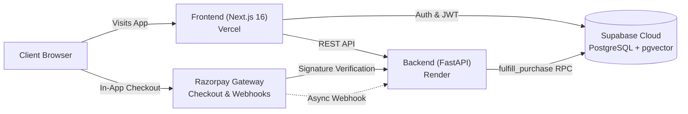

# 🛡️ TraceClause AI — Enterprise Legal Contract Auditor

An enterprise-grade, decoupled legal contract audit platform built with **Next.js 16 (React 19), FastAPI, LangChain, Supabase pgvector, Multi-LLM reasoning (Google Gemini 1.5 Pro / Claude 3.5 Sonnet / GPT-4o), Razorpay Monetization, and Native .docx Redline Exports**.


---

## 🌟 Overview & Key Capabilities

**TraceClause AI** transforms unstructured, complex legal agreements into structured, high-precision risk assessments. Built for legal professionals, enterprise procurement teams, and in-house counsel:

- **Split-Screen Review Dashboard**: Synchronized 50/50 dual-pane interface showing extracted contract text side-by-side with categorized, color-coded clause risk cards (High, Medium, Low).
- **Interactive RAG AI Assistant**: Context-aware Q&A agent backed by pgvector similarity search, providing instant answers and verifiable contract clause citations.
- **Native Word (.docx) Redline Export Engine**: Generates standard Microsoft Word `.docx` redline documents with strikethrough original language, underlined counter-proposals, and risk callout boxes.
- **Enterprise Security & Zero Retention**: Documents are streamed and parsed entirely in server RAM (PyMuPDF & python-docx). No contract files or raw prompt payloads are retained on disk or used for model training.
- **Multi-Tier Quota Governance**:
  - **Free Tier**: 3 lifetime full-contract audits to evaluate capabilities.
  - **Solo Plan ($79/mo)**: 20 monthly audits, `.docx` redline exports, and interactive RAG Assistant access.
  - **Team Plan ($299/mo)**: 100 pooled monthly audits, team workspace collaboration, and multi-seat access.
- **Razorpay Payment Engine**: Server-authoritative order creation, in-app standard checkout modal, HMAC-SHA256 signature verification, and atomic database entitlement fulfillment via PostgreSQL stored procedures.

---

## 🏗️ Architecture & Tech Stack



| Layer | Technologies Used |
| :--- | :--- |
| **Frontend** | Next.js 16 (App Router), React 19, Tailwind CSS, Lucide Icons |
| **Backend API** | Python 3.12, FastAPI, Uvicorn, Pydantic v2 |
| **Parsing & Redlines** | PyMuPDF, python-docx |
| **Vector DB & Search** | Supabase PostgreSQL (`pgvector`), OpenAI / Gemini embeddings, HNSW Index |
| **AI Reasoning** | Google Gemini 1.5 Pro, Anthropic Claude 3.5 Sonnet, OpenAI GPT-4o (Auto-detects active key) |
| **Payment Gateway** | Razorpay SDK (Cards, Netbanking, UPI, International Payments) |
| **Database & Auth** | Supabase Cloud (Row Level Security, Column Grants, Trigger Protections) |

---

## 🚀 Quickstart & Local Setup

### Prerequisites
- **Python 3.12+**
- **Node.js 20+ / 22+ LTS**
- **Supabase Account** with a PostgreSQL database instance

---

### 1. Database Initialization
1. In your **Supabase Dashboard**, open the **SQL Editor**.
2. Run the master schema hardening script:
   [`supabase/migrations/20261105_production_master_hardening.sql`](supabase/migrations/20261105_production_master_hardening.sql)
3. This creates all necessary tables (`profiles`, `audit_reports`, `document_embeddings`, `purchases`, `processed_webhooks`), RLS policies, trigger defenses, and stored procedures.

---

### 2. Backend Setup (FastAPI)

```bash
# 1. Navigate to backend directory
cd backend

# 2. Create and activate virtual environment
python3 -m venv venv
source venv/bin/activate

# 3. Install Python dependencies
pip install -r requirements.txt

# 4. Configure environment
cp .env.example .env
# Edit .env with your Supabase, AI Provider, and Razorpay test keys

# 5. Launch FastAPI development server
uvicorn app.main:app --reload --port 8000
```
- **API URL**: `http://localhost:8000`
- **Interactive OpenAPI Documentation**: `http://localhost:8000/docs`

---

### 3. Frontend Setup (Next.js)

```bash
# 1. Open new terminal and navigate to frontend directory
cd frontend

# 2. Install dependencies
npm install

# 3. Configure environment
cp .env.example .env.local
# Edit .env.local with NEXT_PUBLIC_API_URL and Supabase public keys

# 4. Launch Next.js development server
npm run dev
```
- **Web Application**: `http://localhost:3000`

---

## 🔑 Environment Variables Reference

Sanitized templates are provided in the repository:
- **Backend**: [`backend/.env.example`](backend/.env.example)
- **Frontend**: [`frontend/.env.example`](frontend/.env.example)

### Essential Production Variables

#### Backend (`backend/.env`)
```env
PROJECT_NAME="TraceClause AI"
VERSION="2.0.0"
API_V1_STR="/api/v1"
ENVIRONMENT="production"
ALLOW_DEMO_AUTH="false"
SECRET_KEY="<random-64-character-jwt-secret>"
ALLOWED_ORIGINS="https://your-frontend.vercel.app,http://localhost:3000"

# AI Provider (System auto-detects whichever key is provided)
GEMINI_API_KEY="AIzaSy..."
OPENAI_API_KEY="sk-proj-..."
ANTHROPIC_API_KEY="sk-ant-..."

# Supabase Database & Auth
SUPABASE_URL="https://your-project.supabase.co"
SUPABASE_PUBLISHABLE_KEY="sb_publishable_..."
SUPABASE_SECRET_KEY="sb_secret_..."
SUPABASE_JWKS_URL="https://your-project.supabase.co/auth/v1/.well-known/jwks.json"

# Razorpay Payment Gateway
RAZORPAY_KEY_ID="rzp_test_..."
RAZORPAY_KEY_SECRET="your_secret_key"
RAZORPAY_WEBHOOK_SECRET="your_webhook_secret"
```

#### Frontend (`frontend/.env.local`)
```env
NEXT_PUBLIC_API_URL="https://your-backend.onrender.com/api/v1"
NEXT_PUBLIC_SUPABASE_URL="https://your-project.supabase.co"
NEXT_PUBLIC_SUPABASE_ANON_KEY="sb_publishable_..."
NEXT_PUBLIC_RAZORPAY_KEY_ID="rzp_test_..."
```

---

## 🌐 REST API Endpoints

| Method | Endpoint Route | Access / Guard | Description |
| :--- | :--- | :--- | :--- |
| `GET` | `/api/v1/health` | Public | Healthcheck and deployment status |
| `POST` | `/api/v1/documents/upload` | Authenticated | Parses PDF/DOCX contract into RAM text |
| `POST` | `/api/v1/contract/analyze` | Quota Guarded | Audits contract clauses & generates risk analysis |
| `GET` | `/api/v1/contract/my-reports` | Authenticated | Fetches user audit history |
| `GET` | `/api/v1/contract/{report_id}/export-docx` | `docx_export` Guard | Generates & streams Microsoft Word `.docx` redline file |
| `POST` | `/api/v1/rag/chat` | `rag_interactive_chat` Guard | Contextual contract Q&A with clause citations |
| `POST` | `/api/v1/payments/razorpay/create-order` | Authenticated | Server-authoritative order creation |
| `POST` | `/api/v1/payments/razorpay/verify-checkout` | Authenticated | Verifies payment signature & captures entitlement |
| `POST` | `/api/v1/payments/razorpay/webhook` | Webhook Signature | Idempotent background fulfillment receiver |
| `GET/POST`| `/api/v1/workspaces/` | `workspace_management` Guard | Team workspace and member seat management |

---

## 🚀 Production Deployment Guide

For complete, step-by-step instructions on deploying the frontend to **Vercel**, deploying the backend to **Render**, generating Razorpay credentials, and connecting all services, see our dedicated guide:

👉 **[Production Deployment & Razorpay Integration Guide](DEPLOYMENT_AND_RAZORPAY_GUIDE.md)**

---

## 📚 Architectural Specifications (`docs/`)

Explore the underlying architecture and specifications in the [`docs/`](docs/) directory:

1. 📄 [01. Low-Level Wiring & System Data Flow](docs/01-low-level-wiring.md)
2. 📄 [02. Points of Failure & Risk Mitigation](docs/02-point-of-failures.md)
3. 📄 [03. Frontend Architecture (Next.js Blueprint)](docs/03-frontend-architecture.md)
4. 📄 [04. Backend Architecture (FastAPI Blueprint)](docs/04-backend-architecture.md)
5. 📄 [05. Payment Integration & Monetization Logic](docs/05-payment-integration.md)
6. 📄 [06. API Contracts & Token Budget Governance](docs/06-api-contracts-and-limits.md)
7. 📄 [07. Evaluation & Quality Assurance Metrics](docs/07-test-metrics.md)
8. 📄 [08. Deployment Runbook & Release Guide](docs/08-deployment-runbook.md)
9. 🎓 [09. RAG Architecture & Legal Audit Engine](docs/09-interview-rag-architecture-deep-dive.md)
10. 📄 [10. System Architecture & Database Roadmap](docs/10-system-architecture-env-db-roadmap.md)
11. 📄 [11. Database Schema & Vector Storage Deep Dive](docs/11-database-schema-vector-storage-deep-dive.md)

---

## 📜 Compliance & Legal
- [Terms of Service](TERMS_OF_SERVICE.md)
- [Privacy Policy](PRIVACY_POLICY.md)

---

## 📄 License
Distributed under the MIT License.
