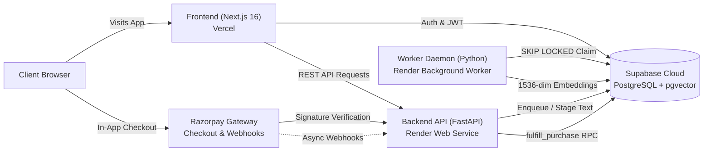

# 🛡️ TraceClause AI — Enterprise Legal Contract Auditor

An enterprise-grade, decoupled legal contract audit platform built with **Next.js 16 (React 19), FastAPI 0.115, LangChain, Supabase pgvector, Multi-LLM reasoning (Google Gemini 1.5 Pro / Claude 3.5 Sonnet / GPT-4o), Asynchronous Durable Job Queue, Razorpay Monetization, and Native .docx Redline Exports**.


---

## 🌟 Overview & Key Capabilities

**TraceClause AI** transforms unstructured, complex legal agreements into structured, high-precision risk assessments. Built for legal professionals, enterprise procurement teams, and in-house counsel:

- **Split-Screen Review Dashboard**: Synchronized 50/50 dual-pane interface showing extracted contract text side-by-side with categorized, color-coded clause risk cards (High, Medium, Low).
- **Asynchronous Durable Queue with Live Stage Tracking**: Heavy agreements ($>30$ pages) run via a PostgreSQL-backed job queue with `FOR UPDATE SKIP LOCKED`, monotonic fencing tokens, and a real-time progress bar in the UI ($20\% \to 50\% \to 80\% \to 100\%$).
- **Supervised Background Worker Daemon & Continuous Heartbeats**: Independent worker daemon (`app/worker_daemon.py`) with bounded concurrency (2 concurrent jobs for beta), automated orphan reclamation, and continuous 15s background heartbeat pings during long model calls to prevent premature lease reclamation.
- **Strict Fail-Closed Legal Risk Engine**: Omitted, malformed, or missing model output strictly fails closed (`RuntimeError`) and refunds quota rather than dangerously assuming "Low Risk" or "Acceptable as written".
- **Durable AI Provider Budget Ledger**: Built with integer microdollars ($1 USD = 1,000,000 microdollars) and PostgreSQL row-level locks (`FOR UPDATE`). Checks, reserves, settles, and releases spend before every batch and retry across API and worker instances via `ai_budget_service.py` and `reserve_ai_budget` stored procedures.
- **Fenced & Atomic Report Cleanup**: Terminal failure transition (`fail_analysis_job` RPC) verifies `(job_id, fencing_token, status='processing')` before mutating data. Removes all partial reports and embeddings atomically, refunds quota, and purges staged text inside a single PostgreSQL transaction with zero unfenced Python deletes.
- **Shared Redis Rate Limiting & Trusted Proxy Defense**: Redis-backed sliding-window rate limiter powered by atomic Lua scripts (`rl:ip`, `rl:upload`, `rl:audit`, `rl:rag`). Safely extracts client IP respecting `settings.TRUSTED_PROXIES` (`X-Real-IP` and rightmost `X-Forwarded-For`), returns `HTTP 429` with `Retry-After`, and fails closed with `HTTP 503` on Redis outages for expensive routes.
- **Interactive Grounded RAG Assistant**: Context-aware Q&A agent backed by pgvector cosine similarity search, providing instant answers and verifiable contract clause citations.
- **Native Word (.docx) Redline Export Engine**: Generates standard Microsoft Word `.docx` redline documents with strikethrough original language, underlined counter-proposals, and risk callout boxes.
- **Enterprise Security & Zero Disk Retention**: Documents are streamed and parsed entirely in server RAM (PyMuPDF & python-docx) with zero disk retention. Staged text payloads are automatically purged upon audit completion or failure.
- **Multi-Tier Quota Governance**:
  - **Free Tier**: 3 lifetime full-contract audits to evaluate capabilities.
  - **Solo Plan ($79/mo)**: 20 monthly audits, `.docx` redline exports, and interactive RAG Assistant access.
  - **Team Plan ($299/mo)**: 100 pooled monthly audits, team workspace collaboration, multi-seat access, and direct priority beta email support.
- **Razorpay Payment Engine**: Server-authoritative order creation, in-app standard checkout modal, HMAC-SHA256 signature verification, and atomic database entitlement fulfillment via PostgreSQL stored procedures.
- **Strictly Pinned Dependencies**: Python dependencies in `requirements.txt` are pinned to exact versions (`==`) for repeatable, deterministic production deployments.
- **Staging Release Gate & Verification Runbook**: Documented operational verification runbook ([`docs/13-staging-release-gate-and-verification.md`](docs/13-staging-release-gate-and-verification.md)) covering a 10-step end-to-end test sequence, worker crash recovery, AI budget gate trip tests, and sign-off logging.

---

## 🏗️ Architecture & Tech Stack



| Layer | Technologies Used |
| :--- | :--- |
| **Frontend** | Next.js 16 (App Router), React 19, Tailwind CSS, Lucide Icons |
| **Backend API** | Python 3.12, FastAPI, Uvicorn, Pydantic v2, Tenacity |
| **Queue & Worker** | PostgreSQL Queue (`SKIP LOCKED`), Fencing Tokens, Supervised Worker Daemon |
| **Parsing & Redlines** | PyMuPDF (fitz), python-docx (OpenXML XML manipulation) |
| **Vector DB & Search** | Supabase PostgreSQL (`pgvector`), OpenAI / Gemini embeddings, HNSW Index |
| **AI Reasoning** | Google Gemini 1.5 Pro, Anthropic Claude 3.5 Sonnet, OpenAI GPT-4o (Auto-detects active key) |
| **Payment Gateway** | Razorpay SDK (Cards, Netbanking, UPI, International Payments) |
| **Database & Auth** | Supabase Cloud (Row Level Security, Column Grants, Trigger Protections) |

---

## 🚀 Quickstart & Local Setup

### Prerequisites
- **Python 3.12+**
- **Node.js 20+ / 22+ LTS**
- **Supabase Account** with a PostgreSQL database instance

---

### 1. Database Initialization
1. In your **Supabase Dashboard**, open the **SQL Editor**.
2. Run the master schema hardening script:
   [`supabase/migrations/20261105_production_master_hardening.sql`](supabase/migrations/20261105_production_master_hardening.sql)
3. Run the durable AI budget and fenced cleanup migration:
   [`supabase/migrations/20261118_durable_ai_budget_and_fenced_cleanup.sql`](supabase/migrations/20261118_durable_ai_budget_and_fenced_cleanup.sql)
4. This creates all necessary tables (`profiles`, `workspaces`, `workspace_members`, `contract_reports`, `contract_embeddings`, `quota_reservations`, `processed_webhooks`, `purchases`, `contract_analysis_jobs`, `staged_job_payloads`, `ai_budget_periods`, `ai_usage_reservations`), RLS policies, trigger defenses, and atomic stored procedures.

---

### 2. Backend Setup (FastAPI)

```bash
# 1. Navigate to backend directory
cd backend

# 2. Create and activate virtual environment
python3 -m venv venv
source venv/bin/activate

# 3. Install Python dependencies
pip install -r requirements.txt

# 4. Configure environment
cp .env.example .env
# Edit .env with your Supabase, AI Provider, and Razorpay test keys

# 5. Launch FastAPI development server
uvicorn app.main:app --reload --port 8000
```
- **API URL**: `http://localhost:8000`
- **Interactive OpenAPI Documentation**: `http://localhost:8000/docs`

#### Running the Background Worker Daemon (Optional / Production)
In a separate terminal, launch the supervised worker daemon:
```bash
cd backend
source venv/bin/activate
python -m app.worker_daemon
```

---

### 3. Frontend Setup (Next.js)

```bash
# 1. Open new terminal and navigate to frontend directory
cd frontend

# 2. Install dependencies
npm install

# 3. Configure environment
cp .env.example .env.local
# Edit .env.local with NEXT_PUBLIC_API_URL and Supabase public keys

# 4. Launch Next.js development server
npm run dev
```
- **Web Application**: `http://localhost:3000`

---

## 🧪 Testing & Verification

### Running Automated Backend Tests
The repository contains 33 comprehensive unit and integration tests covering upload security, magic bytes, ZIP bomb inspection, quota reservations, cross-tenant isolation, job queue concurrency, and Razorpay signature verification:

```bash
cd backend
source venv/bin/activate
pytest tests/
```
Output:
```text
======================== 42 passed, 8 warnings in 2.93s ========================
```

### Running Load Tests (Locust)
Simulate realistic 10-, 20-, 50-, and 100-user concurrent contract audit workloads:
```bash
cd backend
source venv/bin/activate
locust -f tests/locustfile.py --host http://localhost:8000
```

---

## 🔑 Environment Variables Reference

Sanitized templates are provided in the repository:
- **Backend**: [`backend/.env.example`](backend/.env.example)
- **Frontend**: [`frontend/.env.example`](frontend/.env.example)

### Essential Production Variables

#### Backend (`backend/.env`)
```env
PROJECT_NAME="TraceClause AI"
VERSION="2.0.0"
API_V1_STR="/api/v1"
ENVIRONMENT="production"
ALLOW_DEMO_AUTH="false"
SECRET_KEY="<random-64-character-jwt-secret>"
ALLOWED_ORIGINS="https://your-frontend.vercel.app,http://localhost:3000"

# AI Provider (System auto-detects whichever key is provided)
GEMINI_API_KEY="AIzaSy..."
OPENAI_API_KEY="sk-proj-..."
ANTHROPIC_API_KEY="sk-ant-..."

# Supabase Database & Auth
SUPABASE_URL="https://your-project.supabase.co"
SUPABASE_PUBLISHABLE_KEY="sb_publishable_..."
SUPABASE_SECRET_KEY="sb_secret_..."
SUPABASE_JWKS_URL="https://your-project.supabase.co/auth/v1/.well-known/jwks.json"

# Razorpay Payment Gateway
RAZORPAY_KEY_ID="rzp_test_..."
RAZORPAY_KEY_SECRET="your_secret_key"
RAZORPAY_WEBHOOK_SECRET="your_webhook_secret"
```

#### Frontend (`frontend/.env.local`)
```env
NEXT_PUBLIC_API_URL="https://your-backend.onrender.com/api/v1"
NEXT_PUBLIC_SUPABASE_URL="https://your-project.supabase.co"
NEXT_PUBLIC_SUPABASE_ANON_KEY="sb_publishable_..."
NEXT_PUBLIC_RAZORPAY_KEY_ID="rzp_test_..."
```

---

## 🌐 REST API Endpoints

| Method | Endpoint Route | Access / Guard | Description |
| :--- | :--- | :--- | :--- |
| `GET` | `/api/v1/health/live` | Public | Lightweight liveness probe (<5ms, no DB/AI calls) |
| `GET` | `/api/v1/health/ready` | Public | Database readiness and active queue depth observation |
| `POST` | `/api/v1/documents/upload` | Authenticated | Parses PDF/DOCX contract into RAM text (semaphore throttled) |
| `POST` | `/api/v1/jobs/submit` | Authenticated | Submits audit to durable PostgreSQL queue (<200ms response) |
| `GET` | `/api/v1/jobs/{job_id}` | Authenticated | Real-time polling endpoint returning progress & audit report |
| `POST` | `/api/v1/contract/analyze` | Quota Guarded | Synchronous fallback audit endpoint |
| `GET` | `/api/v1/contract/my-reports` | Authenticated | Fetches user audit history with cross-tenant isolation |
| `GET` | `/api/v1/contract/{report_id}/export-docx` | `docx_export` Guard | Streams Microsoft Word `.docx` redline file |
| `DELETE`| `/api/v1/contract/{report_id}` | Authenticated | Permanently deletes contract report and vector embeddings |
| `DELETE`| `/api/v1/contract/delete-account` | Authenticated | GDPR right-to-erasure cascading account deletion |
| `POST` | `/api/v1/rag/chat` | `rag_interactive_chat` Guard | Contextual contract Q&A with clause citations |
| `POST` | `/api/v1/payments/razorpay/create-order` | Authenticated | Server-authoritative order creation |
| `POST` | `/api/v1/payments/razorpay/verify-checkout` | Authenticated | Verifies payment signature & captures entitlement |
| `POST` | `/api/v1/payments/razorpay/webhook` | Webhook Signature | Idempotent background fulfillment receiver |
| `GET/POST`| `/api/v1/workspaces/` | `workspace_management` Guard | Team workspace and member seat management |

---

## 📚 Architectural Documentation & Production Runbooks

Explore the deep architectural documentation and production guides:

1. 🏛️ **[Technical Systems Architecture Documentation](SYSTEM_ARCHITECTURE_DOCUMENTATION.md)** — Comprehensive 6-module systems engineering blueprint.
2. 🚀 **[Production Go-Live Hardening Plan & Launch Gates](PRODUCTION_GO_LIVE_HARDENING_PLAN.md)** — Staged concurrency gates, 10 launch acceptance criteria, and scaling plan.
3. 📘 **[Incident & Operations Runbook](docs/12-incident-and-operations-runbook.md)** — Stalled worker recovery, circuit breakers, manual payment fulfillment, and telemetry.
4. 💳 **[Production Deployment & Razorpay Integration Guide](DEPLOYMENT_AND_RAZORPAY_GUIDE.md)** — Step-by-step production rollout guide.
5. 📄 **[Low-Level Wiring & System Data Flow](docs/01-low-level-wiring.md)**
6. 📄 **[Points of Failure & Risk Mitigation](docs/02-point-of-failures.md)**
7. 📄 **[Frontend Architecture Blueprint](docs/03-frontend-architecture.md)**
8. 📄 **[Backend Architecture Blueprint](docs/04-backend-architecture.md)**
9. 📄 **[Database Schema & Vector Storage Deep Dive](docs/11-database-schema-vector-storage-deep-dive.md)**

---

## 📜 Compliance & Legal
- [Terms of Service](TERMS_OF_SERVICE.md)
- [Privacy Policy](PRIVACY_POLICY.md)

---

## 📄 License
Distributed under the MIT License.
