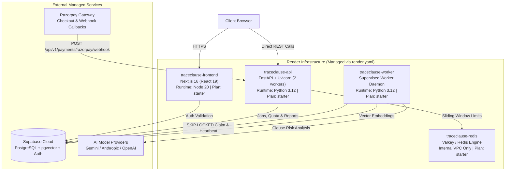

# 📘 Render Blueprint Deployment & Production Operations Guide

This guide documents the complete deployment, configuration, and day-2 operations of **TraceClause AI** using a unified **Render Blueprint (`render.yaml`)**.

---

## 1. Architecture & Service Topology

The entire application runs under a single Render Blueprint dashboard, managing four interconnected services with zero-downtime rolling deployments:



| Service Name | Render Type | Runtime | Root Dir | Build Command | Start Command | Plan |
| :--- | :--- | :--- | :--- | :--- | :--- | :--- |
| `traceclause-frontend` | `web` | `node` | `frontend` | `npm ci && npm run build` | `npm run start` | `starter` |
| `traceclause-api` | `web` | `python` | `backend` | `pip install -r requirements.txt` | `uvicorn app.main:app --host 0.0.0.0 --port $PORT --workers 2` | `starter` |
| `traceclause-worker` | `worker` | `python` | `backend` | `pip install -r requirements.txt` | `python -m app.worker_daemon` | `starter` |
| `traceclause-redis` | `keyvalue` | *(managed)*| — | — | — | `starter` |

> [!IMPORTANT]
> **Always-On Instance Tier (`plan: starter`)**: Free-tier instances spin down after 15 minutes of inactivity, causing high cold-start latencies, broken background polling, dropped payment webhooks, and stalled worker daemon tasks. For a safe beta launch with paying users, `plan: starter` ensures continuous background execution and immediate API responsiveness.

---

## 2. Prerequisites

Before creating the Blueprint on Render, ensure you have:
1. **Render Account**: With payment method active (to provision `starter` plans).
2. **Supabase Project**: An active PostgreSQL instance with `pgvector` and GoTrue Authentication enabled.
3. **Razorpay Account**: Active Test or Live API keys (`Key ID` and `Key Secret`).
4. **AI Provider API Key**: At least one active key from:
   - Google Gemini (`GEMINI_API_KEY`) — Recommended default (`gemini-1.5-pro` & `text-embedding-004`).
   - Anthropic (`ANTHROPIC_API_KEY`) — (`claude-3-5-sonnet-20240620`).
   - OpenAI (`OPENAI_API_KEY`) — (`gpt-4o` & `text-embedding-3-small`).

---

## 3. Database Initialization (Supabase)

Before launching services on Render, execute the two SQL migrations in your Supabase project's **SQL Editor**:

1. **Master Hardening Migration**:
   - File: [`supabase/migrations/20261105_production_master_hardening.sql`](../supabase/migrations/20261105_production_master_hardening.sql)
   - Provisions: `profiles`, `workspaces`, `contract_reports`, `contract_embeddings` (HNSW cosine index), `contract_analysis_jobs` (`SKIP LOCKED` queue), `staged_job_payloads`, `purchases`, and RLS policies.
2. **Durable AI Budget & Fenced Cleanup Migration**:
   - File: [`supabase/migrations/20261118_durable_ai_budget_and_fenced_cleanup.sql`](../supabase/migrations/20261118_durable_ai_budget_and_fenced_cleanup.sql)
   - Provisions: `ai_budget_periods`, `ai_usage_reservations`, atomic stored procedures (`reserve_ai_budget`, `settle_ai_budget`, `release_ai_budget`, `fail_analysis_job`, and `persist_analysis_report_and_complete`).

### Schema Verification Query
Run in Supabase SQL Editor to confirm all required tables exist:
```sql
SELECT table_name 
FROM information_schema.tables 
WHERE table_schema = 'public' 
  AND table_name IN (
    'profiles', 
    'workspaces', 
    'contract_reports', 
    'contract_embeddings', 
    'contract_analysis_jobs', 
    'staged_job_payloads', 
    'ai_budget_periods', 
    'ai_usage_reservations',
    'purchases'
  );
```
Expected output: 9 rows returned.

---

## 4. First-Time Blueprint Deployment Walkthrough

1. **Push your repository** to GitHub or GitLab.
2. Log into the **[Render Dashboard](https://dashboard.render.com/)**.
3. Click the **New +** button in the top navigation bar and select **Blueprint**.
4. Select your `TraceClause-AI` repository.
5. Render detects the root `render.yaml` and displays the Blueprint configuration preview showing:
   - `traceclause-frontend` (Web Service)
   - `traceclause-api` (Web Service)
   - `traceclause-worker` (Background Worker)
   - `traceclause-redis` (Key Value Store)
6. Supply the required environment variables (marked with `sync: false`) in the Blueprint creation form (see checklist below).
7. Click **Apply**.
8. Render will provision the Key Value store first, then build and deploy the services.

---

## 5. Environment Variable Checklist

### 5.1 Frontend Web Service (`traceclause-frontend`)
| Variable | Required | Source | Description |
| :--- | :--- | :--- | :--- |
| `NODE_VERSION` | Yes | `20.18.0` (set in yaml) | Node.js LTS version |
| `NEXT_PUBLIC_API_URL` | Yes | Dashboard | Public API endpoint: `https://<api-subdomain>.onrender.com/api/v1` |
| `NEXT_PUBLIC_SUPABASE_URL` | Yes | Supabase Dashboard | Project Settings -> API -> Project URL |
| `NEXT_PUBLIC_SUPABASE_ANON_KEY` | Yes | Supabase Dashboard | Project Settings -> API -> `anon` public key |
| `NEXT_PUBLIC_RAZORPAY_KEY_ID` | Optional | Razorpay Dashboard | Razorpay Public Key ID (e.g. `rzp_test_...`) |

> [!CAUTION]
> **No Backend Secrets in Frontend**: Never set `SUPABASE_SERVICE_ROLE_KEY`, `RAZORPAY_KEY_SECRET`, `RAZORPAY_WEBHOOK_SECRET`, or AI API keys on the frontend. Next.js inlines all `NEXT_PUBLIC_*` variables into the public browser bundle.

### 5.2 Backend API Web Service (`traceclause-api`)
| Variable | Required | Source | Description |
| :--- | :--- | :--- | :--- |
| `PYTHON_VERSION` | Yes | `3.12.3` (set in yaml) | Python runtime |
| `ENVIRONMENT` | Yes | `production` (set in yaml) | Enforces strict security validation |
| `ALLOW_DEMO_AUTH` | Yes | `false` (set in yaml) | Blocks unauthenticated mock login |
| `ALLOW_SYNCHRONOUS_ANALYSIS` | Yes | `false` (set in yaml) | Forces heavy audits into durable queue |
| `RUN_WORKER_IN_PROCESS` | Yes | `false` (set in yaml) | Offloads job execution to dedicated worker |
| `SECRET_KEY` | Yes | Auto-generated (`generateValue`) | Cryptographic secret for session tokens |
| `ALLOWED_ORIGINS` | Yes | Dashboard | Deployed frontend domain: `https://<frontend-subdomain>.onrender.com` |
| `TRUSTED_PROXIES` | Yes | `10.0.0.0/8,127.0.0.1,::1` | Render internal reverse proxy CIDR subnets |
| `REDIS_URL` | Yes | Auto-linked (`fromService`) | Valkey/Redis connection string |
| `FAIL_CLOSED_ON_REDIS_ERROR` | Yes | `true` (set in yaml) | Prevents bypass during Redis downtime |
| `SUPABASE_URL` | Yes | Supabase Dashboard | Project Settings -> API -> Project URL |
| `SUPABASE_KEY` | Yes | Supabase Dashboard | Project Settings -> API -> `anon` public key |
| `SUPABASE_SERVICE_ROLE_KEY` | Yes | Supabase Dashboard | Project Settings -> API -> `service_role` secret |
| `OPENAI_API_KEY` | At least 1 AI key | OpenAI Platform | Required if using OpenAI GPT-4o / embeddings |
| `GEMINI_API_KEY` | At least 1 AI key | Google AI Studio | Required if using Gemini 1.5 Pro / embeddings |
| `ANTHROPIC_API_KEY` | At least 1 AI key | Anthropic Console | Required if using Claude 3.5 Sonnet |
| `RAZORPAY_KEY_ID` | Yes | Razorpay Dashboard | API Keys -> Key ID (`rzp_test_...` or `rzp_live_...`) |
| `RAZORPAY_KEY_SECRET` | Yes | Razorpay Dashboard | API Keys -> Key Secret |
| `RAZORPAY_WEBHOOK_SECRET` | Yes | Dashboard & Razorpay | High-entropy string shared with Razorpay |

### 5.3 Background Worker (`traceclause-worker`)
| Variable | Required | Source | Description |
| :--- | :--- | :--- | :--- |
| `PYTHON_VERSION` | Yes | `3.12.3` (set in yaml) | Python runtime |
| `ENVIRONMENT` | Yes | `production` (set in yaml) | Production mode |
| `WORKER_CONCURRENCY` | Yes | `2` (set in yaml) | Beta concurrency limit |
| `SUPABASE_URL` | Yes | Supabase Dashboard | Project Settings -> API -> Project URL |
| `SUPABASE_SERVICE_ROLE_KEY` | Yes | Supabase Dashboard | Supabase `service_role` secret for queue claims |
| `OPENAI_API_KEY` | At least 1 AI key | OpenAI Platform | Required for model inference |
| `GEMINI_API_KEY` | At least 1 AI key | Google AI Studio | Required for model inference |
| `ANTHROPIC_API_KEY` | At least 1 AI key | Anthropic Console | Required for model inference |

---

## 6. Post-Deployment Webhook Configuration (Razorpay)

To automatically fulfill credits and subscription tier upgrades upon payment completion:

1. Log into your **[Razorpay Dashboard](https://dashboard.razorpay.com/)**.
2. Navigate to **Settings** -> **Webhooks**.
3. Click **Add New Webhook**.
4. Configure the following fields:
   - **Webhook URL**: `https://<traceclause-api-subdomain>.onrender.com/api/v1/payments/razorpay/webhook` (or your custom API domain).
   - **Secret**: Enter the exact same string set in `RAZORPAY_WEBHOOK_SECRET` on Render.
   - **Alert Email**: Enter your engineering alert email.
   - **Active Events**: Check the following events:
     - `payment.captured`
     - `order.paid`
5. Click **Save**.
6. Send a test webhook event from the Razorpay interface to verify `HTTP 200` response.

---

## 7. Post-Deployment Smoke Test & Verification Checklist

Follow this checklist immediately after initial deployment:

### Step 1: Health Probes
```bash
# Liveness probe (<5ms, no external dependencies)
curl -s -i https://<traceclause-api-subdomain>.onrender.com/api/v1/health/live

# Expected response: HTTP 200 OK
# {"status": "alive", "service": "TraceClause AI", "version": "2.0.0", ...}

# Readiness probe (verifies Supabase database connectivity)
curl -s -i https://<traceclause-api-subdomain>.onrender.com/api/v1/health/ready

# Expected response: HTTP 200 OK
# {"status": "ready", "database": "connected", ...}
```

### Step 2: Background Worker Logs
In the Render Dashboard, open `traceclause-worker` -> **Logs**:
- Verify you see:
  ```text
  [worker_daemon] Worker daemon starting up...
  [worker_daemon] Concurrency limit: 2
  [worker_daemon] Janitor loop active
  [worker_daemon] Polling for queued jobs...
  ```
- Confirm there are no `FATAL WORKER MISCONFIGURATION` errors.

### Step 3: Frontend Web Service
- Open `https://<traceclause-frontend-subdomain>.onrender.com` in your browser.
- Verify the landing page loads cleanly with styles and icons.
- Verify Supabase login and authentication flows work.

### Step 4: End-to-End Contract Audit Test
1. Log in to the frontend.
2. Upload a test contract (PDF or DOCX, $<15$ MB).
3. Click **Analyze Contract**.
4. Observe the progress tracker:
   - Status updates from `20%` (parsing & extraction) -> `50%` (AI risk analysis) -> `80%` (vector indexing) -> `100%` (completed).
5. Verify the split-screen review dashboard renders:
   - Left pane: Extracted contract text.
   - Right pane: Clause risk cards (High, Medium, Low) with redline recommendations.
6. Test `.docx` redline download.

### Step 5: Distributed Rate Limiter Verification
Run a rapid request loop to verify Redis sliding-window throttling:
```bash
for i in {1..70}; do curl -s -o /dev/null -w "%{http_code}\n" https://<traceclause-api-subdomain>.onrender.com/; done
```
- Observe HTTP 200 for the first 60 requests.
- Observe HTTP 429 (`Too Many Requests`) with a `Retry-After` header for subsequent requests.

---

## 8. Operations, Scaling, Monitoring & Rollbacks

### 8.1 Concurrency & Scaling Plan
- **Beta Phase (100–500 MAU, 10–20 paying users)**:
  - Keep `WORKER_CONCURRENCY: 2` on 1 worker instance (`plan: starter`).
  - Keep `traceclause-api` on 1 instance (`plan: starter`, 2 Uvicorn workers).
  - PostgreSQL row-level locks (`FOR UPDATE SKIP LOCKED`) ensure single-claim semantics.
- **Scaling Up**:
  - When queue wait times exceed 60 seconds during peak hours, scale `traceclause-worker` to a larger plan (`standard` with more RAM/CPU) or increase `WORKER_CONCURRENCY` to `4`.
  - Additional worker instances can be spun up safely; `FOR UPDATE SKIP LOCKED` guarantees no two workers claim the same job.

### 8.2 Stalled Job Janitor & Orphan Recovery
- The worker daemon runs an automated janitor every 60 seconds (`reclaim_orphaned_jobs`).
- If a worker instance is terminated mid-execution (e.g. during a deploy or OOM), jobs in `processing` status with a stale heartbeat (>5 minutes) are automatically reset to `pending` with incremented attempt counters or transitioned to `failed` with quota refunded.

### 8.3 Circuit Breakers
In the event of an upstream provider outage or emergency:
- **Disable AI processing**: Set `AI_PROCESSING_ENABLED=false` on `traceclause-api` to immediately return `HTTP 503` without burning tokens.
- **Disable uploads**: Set `UPLOADS_ENABLED=false` to block new document ingestion.

### 8.4 Zero-Downtime Rollbacks
If a newly deployed commit introduces unexpected issues:
1. Open the service in the Render Dashboard (`traceclause-api` or `traceclause-frontend`).
2. Navigate to **Deploys**.
3. Locate the last known good deploy.
4. Click the three dots menu (`...`) and select **Rollback to this deploy**.
5. Render immediately switches traffic back to the previous deployment artifact.

