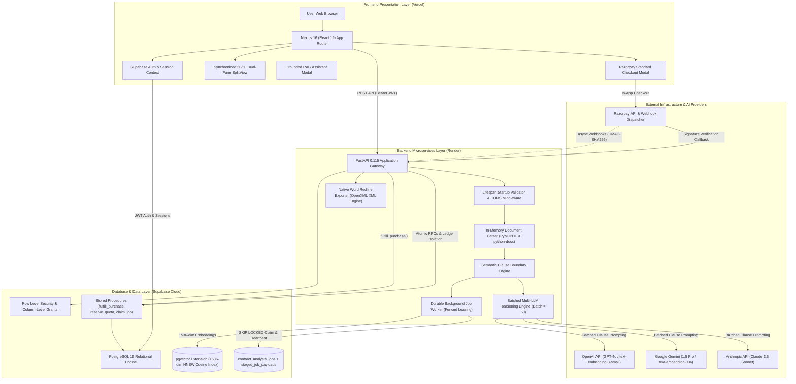
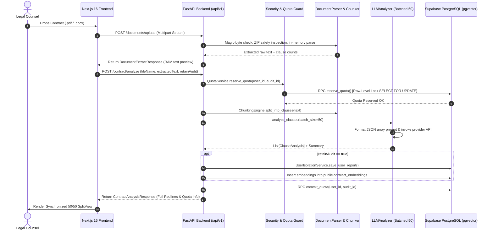
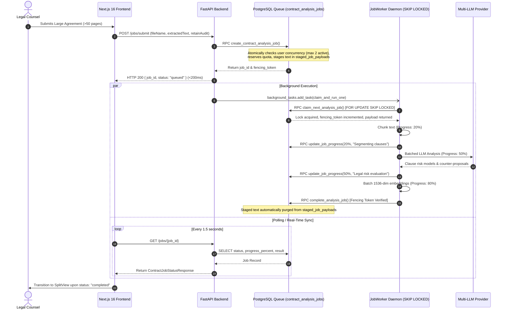
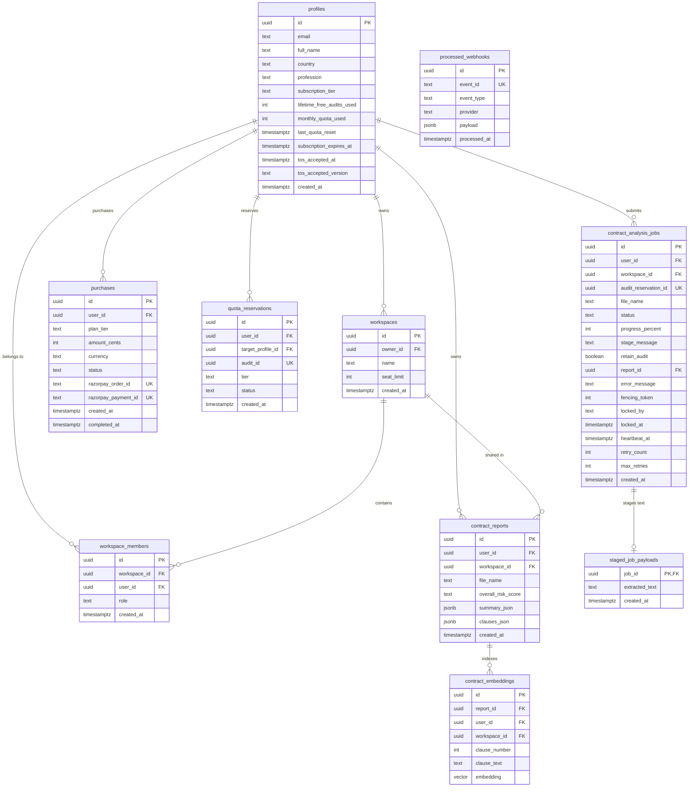
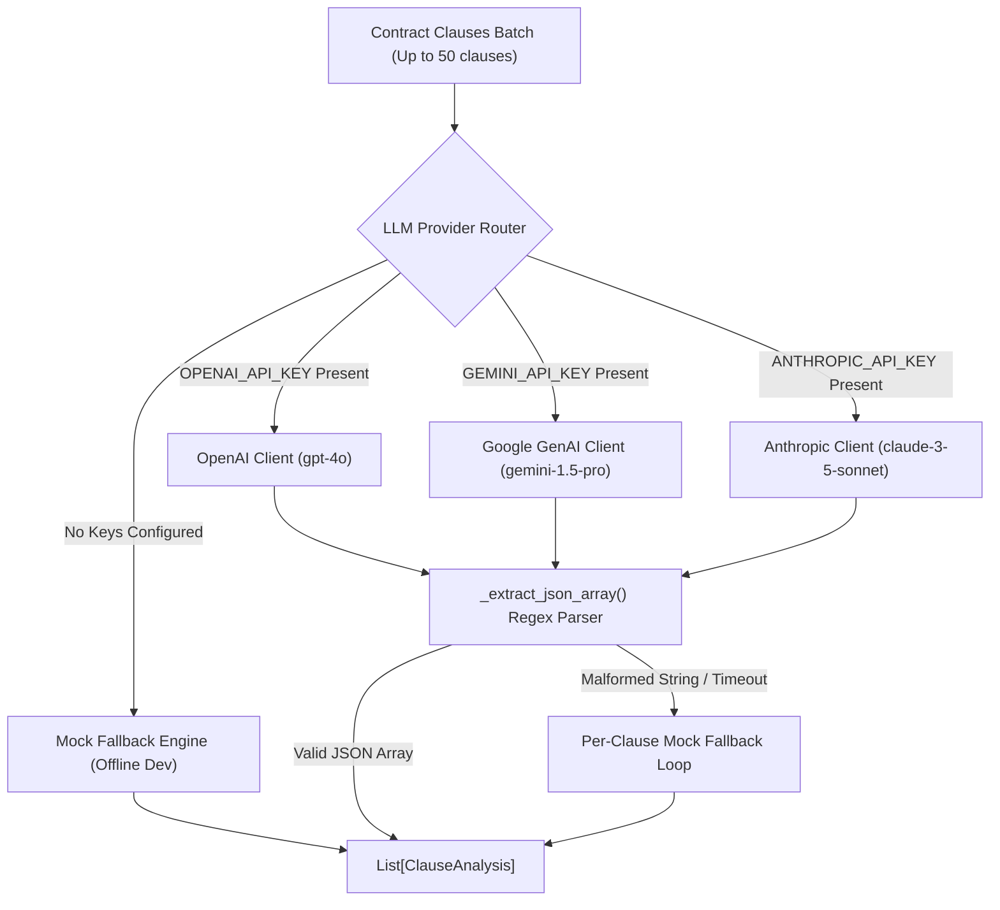
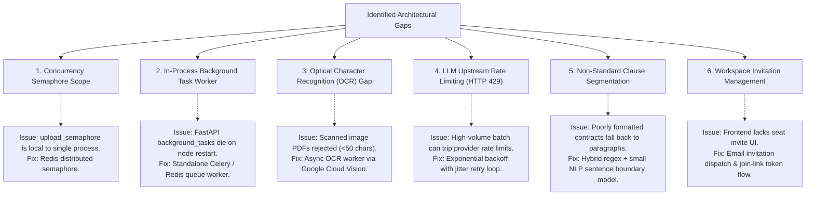

# 🛡️ TraceClause AI (v2.0) — Enterprise Systems Architecture & Technical Documentation
**Author:** Principal Systems Architect  
**Classification:** Enterprise Technical Documentation & Engineering Blueprint  
**System Identity:** TraceClause AI (Engineered upon ScanShield AI v2 Core)  
**Target Environment:** Production Distributed Architecture (Next.js 16 / FastAPI 0.115 / Supabase pgvector / Razorpay)  
**Last System Audit:** Complete End-to-End Codebase Verification  

---

## Executive Summary & System Abstract

**TraceClause AI** is an enterprise-grade, decoupled legal contract audit and risk analysis platform. The system ingests unstructured legal agreements (PDF and Microsoft Word `.docx` documents), performs 100% in-memory parsing with zero disk retention, executes semantic clause segmentation, evaluates commercial liabilities via batched multi-LLM reasoning (OpenAI GPT-4o, Google Gemini 1.5 Pro, and Anthropic Claude 3.5 Sonnet), indexes vector embeddings in PostgreSQL via `pgvector`, and provides interactive grounded RAG question-answering alongside native Microsoft Word redline exports.

The platform implements a server-authoritative monetization and quota governance engine backed by **Razorpay**, multi-seat workspace tenancy, Row-Level Security (RLS) with column-level privilege isolation, and a distributed, fenced asynchronous job queue (`SKIP LOCKED`).



---

# MODULE 1: High-Level Architecture & System Overview

### 1.1 Architectural Paradigm & Decoupled Topology
The platform is architected around a strict **Decoupled Client-Server Microservices Topology**:
1. **Frontend Presentation Tier**: Hosted on **Vercel**, built on Next.js 16 (React 19) utilizing the App Router architecture. It handles client-side state, synchronized DOM scrolling between contract text and clause cards, theme toggles, dynamic script injection for Razorpay Checkout, and reactive UI state transitions.
2. **Backend API & Processing Tier**: Hosted on **Render**, running a high-performance **FastAPI (Python 3.12)** application served via `uvicorn`. The backend operates as a stateless API gateway and background task orchestrator. It executes CPU-bound operations (PDF/DOCX binary parsing, OpenXML XML tree manipulation), network-bound batched LLM analysis, and cryptographic validations.
3. **Database & Vector Store Tier**: Managed **Supabase Cloud (PostgreSQL 15)** instance equipped with the `pgvector` extension, built-in GoTrue Supabase Auth, Row-Level Security (RLS) engines, and PL/pgSQL stored procedures.
4. **Third-Party Gateways**: External connections to multi-LLM providers (Google Gemini, Anthropic Claude, OpenAI) and financial rails (Razorpay Payment Gateway).

### 1.2 End-to-End System Data Flows

#### 1.2.1 Synchronous Contract Audit Flow (Interactive Upload)


#### 1.2.2 Asynchronous Durable Job Queue Flow (Heavy Contracts)


### 1.3 Repository Directory Structure

```text
ScanShield_AI_v2/
├── backend/                              # Python 3.12 / FastAPI API Microservice
│   ├── app/
│   │   ├── api/
│   │   │   └── v1/
│   │   │       ├── api.py                # Main APIRouter mounting all endpoints
│   │   │       └── endpoints/
│   │   │           ├── analysis.py       # Synchronous contract audit, vault & docx export
│   │   │           ├── health.py         # Liveness (/live) and Readiness (/ready) probes
│   │   │           ├── jobs.py           # Asynchronous durable queue submission & status
│   │   │           ├── payments.py       # Razorpay order creation, verification, webhooks
│   │   │           ├── rag.py            # Grounded conversational QA over contracts
│   │   │           ├── upload.py         # In-memory document upload & streaming validation
│   │   │           └── workspace.py      # Team workspace & multi-seat management
│   │   ├── core/
│   │   │   ├── billing_config.py         # Server-authoritative plan catalog & pricing
│   │   │   ├── config.py                 # Pydantic BaseSettings & startup security assertions
│   │   │   ├── dependencies.py           # Profile resolution, expiration & feature gating
│   │   │   └── security.py               # Supabase JWT Bearer token validation & client init
│   │   ├── schemas/
│   │   │   ├── contract.py               # Pydantic models for clauses, summaries, responses
│   │   │   ├── job.py                    # Pydantic models for background queue lifecycle
│   │   │   └── payment.py                # Pydantic models for Razorpay orders & webhooks
│   │   ├── services/
│   │   │   ├── chunking.py               # Regex legal clause segmentation engine
│   │   │   ├── document_parser.py        # In-memory PyMuPDF & python-docx parser
│   │   │   ├── docx_exporter.py          # Word OpenXML redline document generator
│   │   │   ├── job_worker.py             # Background worker with SKIP LOCKED fencing
│   │   │   ├── llm_analyzer.py           # Multi-provider batched LLM engine (Batch = 50)
│   │   │   ├── payment_service.py        # Razorpay API client & atomic fulfillment
│   │   │   ├── quota_service.py          # Atomic quota reservation ledger service
│   │   │   ├── user_isolation.py         # Cross-tenant data boundary enforcement
│   │   │   └── vector_store.py           # Dual embedding generator & pgvector RAG store
│   │   └── main.py                       # FastAPI application entrypoint & CORS middleware
│   ├── tests/                            # Automated Pytest Test Suite
│   │   ├── conftest.py                   # Pytest fixtures and mock client setup
│   │   ├── test_auth_and_isolation.py    # Cross-tenant isolation & RLS tests
│   │   ├── test_jobs_queue.py            # Asynchronous queue concurrency & lifecycle tests
│   │   ├── test_quota_security.py        # Quota reservation & rollback validation
│   │   ├── test_razorpay_lifecycle.py    # Signature verification & fulfillment tests
│   │   └── test_upload_security.py       # ZIP bomb, magic bytes & file limit tests
│   └── requirements.txt                  # Production backend dependencies
│
├── frontend/                             # Next.js 16 (React 19) Presentation Tier
│   ├── public/                           # Static assets, legal PDFs & SVGs
│   ├── src/
│   │   ├── app/
│   │   │   ├── globals.css               # Tailwind CSS theme configurations & animations
│   │   │   ├── layout.tsx                # Root layout with ThemeProvider & AuthProvider
│   │   │   └── page.tsx                  # Main single-page application & state router
│   │   ├── components/
│   │   │   ├── auth/
│   │   │   │   ├── AuthModal.tsx         # Sign in & sign up modal with legal consent
│   │   │   │   ├── AuthView.tsx          # Standalone authentication viewport
│   │   │   │   ├── InteractiveMotionGraphic.tsx # Animated legal shield graphic
│   │   │   │   └── TermsAcceptanceModal.tsx # Mandatory terms & privacy acceptance modal
│   │   │   ├── chat/
│   │   │   │   └── ContractChat.tsx      # Grounded RAG chat sidebar with clause citations
│   │   │   ├── pricing/
│   │   │   │   └── PaymentModal.tsx      # Razorpay checkout trigger & plan selection
│   │   │   ├── review/
│   │   │   │   ├── ClauseCard.tsx        # Structured risk card with counter-language diff
│   │   │   │   └── SplitView.tsx         # 50/50 dual-pane synchronized document viewer
│   │   │   ├── settings/
│   │   │   │   └── SettingsModal.tsx     # User profile, subscription status & account deletion
│   │   │   ├── ui/
│   │   │   │   ├── GlobalBackgroundCanvas.tsx # High-performance particle canvas background
│   │   │   │   └── NetworkBackgroundCanvas.tsx # Alternate neural network background
│   │   │   └── upload/
│   │   │       └── Dropzone.tsx          # Drag-and-drop document upload interface
│   │   ├── context/
│   │   │   ├── AuthContext.tsx           # React context for Supabase auth state & profile
│   │   │   └── ThemeContext.tsx          # Dark/light theme context with localStorage sync
│   │   ├── lib/
│   │   │   ├── api-client.ts             # Axios HTTP client with automatic JWT injection
│   │   │   ├── constants.ts              # Canonical legal versions & system constants
│   │   │   ├── countries.ts              # Country catalog for user profiles
│   │   │   └── supabase.ts               # Browser Supabase client initialization
│   │   └── types/
│   │       ├── auth.ts                   # TypeScript interfaces for auth & profiles
│   │       └── contract.ts               # TypeScript interfaces for clauses & audits
│   ├── package.json                      # Node dependencies & build scripts
│   ├── tailwind.config.js                # Tailwind CSS configuration
│   └── tsconfig.json                     # TypeScript compiler configuration
│
├── supabase/                             # Database Schema & Migrations
│   └── migrations/
│       ├── 20260902_tier_gating_and_workspaces.sql # Initial workspaces & tier columns
│       ├── 20260904_add_tos_acceptance_fields.sql  # Terms of service acceptance fields
│       ├── 20261105_atomic_quota_and_retention.sql # Atomic quota reservation ledger
│       └── 20261105_production_master_hardening.sql # Master schema, RLS, triggers & RPCs
│
├── docs/                                 # Architectural Specifications & Runbooks
│   ├── 01-low-level-wiring.md            # System wiring & batching mechanics
│   ├── 02-point-of-failures.md           # Failure modes & resilience registry
│   ├── 03-frontend-architecture.md       # Next.js component blueprints
│   ├── 04-backend-architecture.md        # FastAPI design principles
│   ├── 05-payment-integration.md         # Razorpay monetization & webhook specs
│   ├── 06-api-contracts-and-limits.md    # API schemas & token budget governance
│   ├── 07-test-metrics.md                # QA metrics & test assertions
│   ├── 08-deployment-runbook.md          # Production deployment guide
│   ├── 09-interview-rag-architecture-deep-dive.md # RAG engine deep dive
│   ├── 10-system-architecture-env-db-roadmap.md   # Architectural roadmap
│   └── 11-database-schema-vector-storage-deep-dive.md # Schema & pgvector deep dive
│
├── DEPLOYMENT_AND_RAZORPAY_GUIDE.md      # Step-by-step production setup guide
├── PRIVACY_POLICY.md                     # Canonical Privacy Policy
├── TERMS_OF_SERVICE.md                   # Canonical Terms of Service
└── README.md                             # Repository entrypoint & quickstart
```

### 1.4 Technology Stack Matrix

| Architectural Layer | Component / Tool | Version / Standard | Technical Rationale & Role |
| :--- | :--- | :--- | :--- |
| **Frontend Framework** | Next.js | `16.3+` | App Router, React Server Components (RSC), Turbopack build optimization, SEO rendering. |
| **UI Runtime** | React | `19.0+` | Concurrent rendering, modern hooks, zero-latency DOM updates during synchronized scrolling. |
| **Styling & Icons** | Tailwind CSS / Lucide | `3.4+` / `0.4+` | Glassmorphic dark/light design system, zero-runtime CSS bundle, accessible legal icons. |
| **Backend Runtime** | Python | `3.12+` | Modern type union syntax (`X \| Y`), high-speed asyncio event loop, robust numeric support. |
| **Web API Framework** | FastAPI | `0.115.0+` | Native OpenAPI/Swagger generation, Pydantic v2 serialization, async dependency injection. |
| **Server ASGI Engine** | Uvicorn | `0.30+` | Lightweight lightning-fast ASGI implementation with uvloop integration. |
| **Document Ingestion** | PyMuPDF (`fitz`) | `1.24+` | 100% in-memory C-speed PDF stream parsing with text block coordinate extraction. |
| **Document Generation** | `python-docx` | `1.1+` | OpenXML Word generator with low-level `w:tcPr` and `w:shd` XML injection for redline formatting. |
| **Vector Database** | PostgreSQL + `pgvector` | `0.7+` | Managed relational DB with native HNSW vector indexing (`vector_cosine_ops`, 1536 dims). |
| **AI Inference** | Google Gemini / Anthropic / OpenAI | `v1` / `v0.34` / `v1.40` | Multi-provider LLM routing: Gemini 1.5 Pro, Claude 3.5 Sonnet, GPT-4o with automatic failover. |
| **Embedding Models** | OpenAI / Google Gemini | `text-embedding-3-small` / `text-embedding-004` | 1536-dimensional native embeddings via Matryoshka Representation Learning (MRL). |
| **Payment Gateway** | Razorpay SDK | `1.4+` | Server-authoritative order creation, standard in-app modal, HMAC-SHA256 signature checks. |

---

# MODULE 2: Backend & API Modules Deep Dive

### 2.1 Core Subsystems (`app/core/`)

#### 2.1.1 Application Lifecycle & Startup Validation (`app/main.py`)
The application utilizes FastAPI's modern `@asynccontextmanager` lifespan protocol. Before serving traffic, the backend executes `settings.validate_security_configuration()`.
- **Fail-Safe Startup Assertion**: In `production` or `staging`, the server refuses to boot if:
  1. `ALLOW_DEMO_AUTH` is set to `True`.
  2. `SECRET_KEY` is missing, default, or fewer than 32 characters.
  3. `SUPABASE_URL`, `SUPABASE_KEY`, or `SUPABASE_SECRET_KEY` are undefined.
  4. None of the three supported AI provider API keys (`OPENAI_API_KEY`, `GEMINI_API_KEY`, `ANTHROPIC_API_KEY`) are present.
- **CORS Middleware Configuration**: Configured with strict origin reflection using Pydantic validators (`assemble_cors_origins`), permitting credentialed requests from authorized frontend origins.

#### 2.1.2 Central Configuration Engine (`app/core/config.py`)
Built on Pydantic `BaseSettings`:
- Normalizes CORS origins from comma-separated strings or JSON arrays.
- Property accessors `supabase_anon_key` and `supabase_admin_key` resolve credential aliases seamlessly.
- Configures document upload security thresholds: `MAX_UPLOAD_SIZE_MB = 15`, `MAX_PAGE_COUNT = 100`, `MAX_ZIP_ENTRIES = 500`, `MAX_DECOMPRESSED_SIZE_MB = 50`, `MAX_COMPRESSION_RATIO = 20.0`, `PARSER_TIMEOUT_SECONDS = 15`.

#### 2.1.3 Authentication & Fail-Closed Security (`app/core/security.py`)
- Provides `get_current_user` FastAPI dependency:
  - Extracts HTTP `Authorization: Bearer <token>` header.
  - Distinguishes missing/malformed tokens (HTTP 401 Unauthorized) from Supabase upstream network outages (HTTP 503 Service Unavailable).
  - Validates tokens against Supabase Auth GoTrue via `supabase.auth.get_user(token)`.
  - Demo tokens (`demo-token`, `guest-token`) are strictly prohibited unless `ALLOW_DEMO_AUTH=True` AND `ENVIRONMENT in ("development", "test")`.

#### 2.1.4 Feature Gating & Quota Permissions (`app/core/dependencies.py`)
- Defines `TIER_PERMISSIONS` dictionary:
  - `free`: `{"risk_score_clause_extraction", "plain_english_explanations"}`
  - `solo`: Adds `{"ai_redline_generation", "docx_export", "rag_interactive_chat"}`
  - `team`: Adds `{"workspace_management", "custom_playbook_rules"}`
- `get_current_profile`: Evaluates `subscription_expires_at` against UTC clock. If expired, the effective tier is dynamically downgraded to `'free'` across all dependent endpoints.
- `require_feature(feature_name)`: Higher-order dependency returning HTTP 403 Forbidden if the user's active tier lacks permissions.

#### 2.1.5 Server-Authoritative Plan Catalog (`app/core/billing_config.py`)
```python
PLAN_CATALOG = {
    "solo": {
        "name": "Solo Plan",
        "amount_cents": 7900,       # $79.00 USD
        "currency": "USD",
        "quota_audits": 20,
        "duration_days": 30
    },
    "team": {
        "name": "Team Plan",
        "amount_cents": 29900,      # $299.00 USD
        "currency": "USD",
        "quota_audits": 100,
        "duration_days": 30
    }
}
```
*Security Invariant:* Clients are never permitted to supply price amounts, currency codes, or audit allowances.

---

### 2.2 REST API Endpoints Specification (`app/api/v1/endpoints/`)

| Method | Route | Security Dependency | Request Schema | Response Schema | Description |
| :--- | :--- | :--- | :--- | :--- | :--- |
| `GET` | `/health/live` | Public | None | JSON `{status, service, version, timestamp}` | Lightweight liveness probe (<5ms, no DB/AI calls). |
| `GET` | `/health/ready` | Public | None | JSON `{status, database, db_latency_ms, active_queue_depth}` | Database readiness & queue depth check. Sanitizes errors. |
| `POST` | `/documents/upload` | `get_current_user` | `UploadFile (multipart/form-data)` | `DocumentExtractResponse` | Streams up to 15MB in RAM, checks magic bytes & ZIP safety, throttled via semaphore. |
| `POST` | `/contract/analyze` | `get_current_user` | JSON `{file_name, extracted_text, retain_audit, workspace_id}` | `ContractAnalysisResponse` | Reserves quota atomically, chunks contract, executes batched LLM analysis, commits quota. |
| `GET` | `/contract/my-reports`| `get_current_user` | None | `List[dict]` | Returns user's Audit Vault history with cross-tenant workspace isolation. |
| `GET` | `/contract/{report_id}/export-docx` | `require_feature("docx_export")` | `report_id: str` | Binary Stream (`application/vnd.openxmlformats...`) | Generates and streams native Word `.docx` redline file. |
| `DELETE`| `/contract/{report_id}` | `get_current_user` | `report_id: str` | JSON `{status, message}` | Permanently deletes report and vector embeddings. Owner/member checked. |
| `DELETE`| `/contract/delete-account` | `get_current_user` | None | JSON `{status, message}` | Complete account eradication: deletes embeddings, reports, quotas, and auth user. |
| `POST` | `/jobs/submit` | `get_current_user` | `ContractJobCreateRequest` | `ContractJobCreateResponse` | Submits contract to durable queue. Enforces max 2 active jobs. Returns in <200ms. |
| `GET` | `/jobs/{job_id}` | `get_current_user` | `job_id: str` | `ContractJobStatusResponse` | Real-time polling endpoint returning progress percentage and final report payload. |
| `POST` | `/rag/chat` | `require_feature("rag_interactive_chat")` | `ChatQueryRequest` | `ChatQueryResponse` | Grounded semantic search or context window Q&A with clause citations. |
| `POST` | `/payments/razorpay/create-order` | `get_current_user` | `RazorpayOrderRequest` | `RazorpayOrderResponse` | Server-priced Razorpay order creation and pending purchase ledger record. |
| `POST` | `/payments/razorpay/verify-checkout` | `get_current_user` | `RazorpayVerifyCheckoutRequest` | `RazorpayVerifyCheckoutResponse` | Validates HMAC-SHA256 signature + calls Razorpay API directly + fulfills entitlements. |
| `POST` | `/payments/razorpay/webhook` | Webhook Signature Header | Raw JSON body | `RazorpayWebhookResponse` | Idempotent background fulfillment receiver. Verifies signature against secret. |
| `GET` | `/workspaces/` | `require_feature("workspace_management")` | None | JSON `{"workspaces": List}` | Lists workspaces owned or joined by the user. Enforced in code. |
| `POST` | `/workspaces/` | `require_feature("workspace_management")` | JSON `{"name": str}` | JSON `{"status", "workspace"}`| Creates a team workspace and registers owner in `workspace_members`. |

---

### 2.3 Business Logic Pipelines & Services (`app/services/`)

#### 2.3.1 In-Memory Document Ingestion Pipeline (`document_parser.py`)
The parser is engineered for high-throughput, zero-retention enterprise compliance:
1. **Magic-Byte Signature Verification**:
   - PDF: Must begin with `%PDF-` (`0x25 0x50 0x44 0x46 0x2D`).
   - DOCX: Must begin with PK zip header `PK\x03\x04` (`0x50 0x4B 0x03 0x04`).
   - Legacy `.doc`: Explicitly identifies OLE2 Compound File magic bytes (`\xd0\xcf\x11\xe0\xa1\xb1\x1a\xe1`) and rejects with HTTP 400.
2. **DOCX Archive & ZIP Bomb Mitigation**:
   - Inspects zip entries via `zipfile.ZipFile(io.BytesIO(file_bytes))`.
   - Rejects archives with `> 500` entries.
   - Rejects uncompressed extraction size `> 50 MB`.
   - Rejects any individual file exceeding a compression ratio of `20.0:1` (for files `> 512 KB`).
   - Asserts OpenXML structure (`word/document.xml` or `[Content_Types].xml`).
3. **PyMuPDF Stream Extraction**:
   - Opens PDF directly from memory buffer via `fitz.open(stream=file_bytes, filetype="pdf")`.
   - Rejects encrypted/password-protected PDFs.
   - Rejects PDFs exceeding 100 pages (`settings.MAX_PAGE_COUNT`).
   - Imposes a strict 15-second wall-clock parsing timeout (`PARSER_TIMEOUT_SECONDS`).
4. **Heuristic Low-Text Detection**:
   - If total extracted characters `< 50`, the document is flagged as an image-only scanned document, prompting the user to run OCR prior to ingestion.
5. **Worker Concurrency Semaphore**:
   - Protected by `upload_semaphore = asyncio.Semaphore(3)` to cap memory utilization during concurrent large uploads.

#### 2.3.2 Semantic Clause Chunking Engine (`chunking.py`)
Contract agreements feature rigid numbering schemes. The `ChunkingEngine` segments text while retaining legal context:
- **Primary Regex Splitter**:
  ```python
  CLAUSE_PATTERN = re.compile(
      r'(?=\n(?:SECTION|Section|CLAUSE|Clause|ARTICLE|Article|\d+\.|\([a-z0-9]+\))\s+)', 
      re.MULTILINE
  )
  ```
- **Normalization**: Strips transient page headers (`--- Page X ---`).
- **Thresholding**: Discards fragments `< 30` characters (header artifacts, page numbers).
- **Paragraph Fallback**: If the contract lacks formal section titles, falls back to double newline (`\n\n`) paragraph segmentation.

#### 2.3.3 Batched Multi-LLM Reasoning Engine (`llm_analyzer.py`)
- **Multi-Provider Auto-Routing**: If `LLM_PROVIDER` is unset, automatically inspects environment variables in order: OpenAI -> Gemini -> Anthropic -> Mock Fallback.
- **Batched Execution (`BATCH_SIZE = 50`)**: Rather than executing 1 LLM request per clause (which causes rate limits and 60+ second latency), the engine bundles up to 50 clauses into a single structured prompt.
- **Resilient JSON Array Recovery (`_extract_json_array`)**:
  - Automatically cleans markdown code fences (` ```json `).
  - Employs regex matching `r'\[\s*\{.*\}\s*\]'` to extract JSON arrays even when models return conversational preamble or reasoning tokens.
  - Matches clauses by `clause_number` or falls back to ordinal index position.
- **Sanitized Logging**: Exception handlers never log contract text, prompt payloads, or confidential clauses, complying with legal zero-retention mandates.

#### 2.3.4 Dual-Provider Vector Store & RAG Engine (`vector_store.py`)
- **Native 1536-Dimensional Embeddings**:
  - OpenAI: `text-embedding-3-small`.
  - Gemini: `models/text-embedding-004` (using `output_dimensionality: 1536` via Matryoshka Representation Learning).
  - Batched embedding generation in chunks of 50 texts.
- **Grounded Semantic Retrieval**:
  - Calls PostgreSQL stored procedure `match_contract_clauses` passing query embedding, `report_id`, `user_id`, `match_count=5`, and `similarity_threshold=0.40`.
  - Formulates an answer using *only* retrieved clauses. Always includes clause citations (e.g. `Clause #8 (87% match)`).
  - Returns "No supporting clauses found" when cosine similarity is below threshold.
  - Falls back to context-window truncation if vector RPC is unavailable.

#### 2.3.5 Durable Background Worker Subsystem (`job_worker.py`)
- **Distributed Concurrency & Fencing**:
  - Implements PostgreSQL `claim_next_analysis_job` using `FOR UPDATE SKIP LOCKED`.
  - Uses monotonic integer fencing tokens (`fencing_token`). If a worker experiences network partition or GC pause and loses its lease, state commits are rejected.
  - Reports incremental progress: 20% (Chunking) -> 50% (LLM Analysis) -> 80% (Embeddings) -> 95% (Persisting) -> 100% (Completed).
  - Automatically purges staged text from `staged_job_payloads` upon completion or terminal failure.

#### 2.3.6 Atomic Quota Reservation Ledger (`quota_service.py`)
- Replaces brittle read-then-write loops with single-transaction atomic stored procedures.
- Execution lifecycle: `reserve_quota(user_id, audit_id)` -> `commit_quota(user_id, audit_id)` or `release_quota(user_id, audit_id)`.
- Fails closed: Database connectivity failures return HTTP 503. Exceeded limits return HTTP 429.

#### 2.3.7 Native Word (.docx) Redline Export Engine (`docx_exporter.py`)
- Generates Microsoft Word documents with full legal redline markup:
  - **Deleted / Original Text**: Strikethrough font in Crimson Red (`RGBColor(225, 29, 72)`).
  - **Proposed Counter-Language**: Underlined bold font in Forest Green (`RGBColor(22, 163, 74)`).
  - **Risk Rationale Callouts**: Single-cell tables styled with background XML shading:
    - High Risk: Light Red (`#FFF1F2`).
    - Medium Risk: Light Amber (`#FEF3C7`).
    - Low Risk: Light Green (`#F0FDF4`).
  - Delivered directly as an in-memory `io.BytesIO` binary stream without writing temporary files to server disk.

---

# MODULE 3: Frontend & UI Architecture

### 3.1 Framework Architecture & Component Hierarchy

The frontend is built with **Next.js 16 (App Router)** and **React 19**, styled using **Tailwind CSS**.

```text
src/app/layout.tsx (Root Layout)
├── ThemeProvider (Dark / Light Theme Context)
└── AuthProvider (Supabase Session, Profile, Quota & Terms Context)
    └── src/app/page.tsx (Main Application Page)
        ├── GlobalBackgroundCanvas (High-performance animated canvas)
        ├── TermsAcceptanceModal (Mandatory blocking legal consent modal)
        ├── AuthModal (Supabase sign in & sign up with profession/country)
        ├── PaymentModal (Razorpay in-app checkout modal)
        ├── SettingsModal (User profile, active plan, delete account)
        ├── Navigation Header (Brand, Quota Badges, Theme Toggle, Auth Buttons)
        │
        ├── [Condition: Tab == 'analyzer' & analysisResult == null]
        │   ├── Hero Section (Value proposition, security guarantees)
        │   ├── Dropzone (Drag-and-drop parsing & status progression)
        │   ├── Interactive UI Preview (Feature walkthrough)
        │   ├── Enterprise Features Grid
        │   ├── Pricing Cards Section
        │   └── FAQ Accordion
        │
        ├── [Condition: Tab == 'analyzer' & analysisResult != null]
        │   └── SplitView (Synchronized 50/50 Dual-Pane Interface)
        │       ├── Left Column: Raw Extracted Contract Text Viewer
        │       └── Right Column:
        │           ├── Filter Bar (ALL, HIGH, MEDIUM, LOW) & Tab Switcher
        │           ├── [Tab: CLAUSES] List of ClauseCard components
        │           └── [Tab: CHAT] ContractChat (Grounded RAG Assistant)
        │
        └── [Condition: Tab == 'history']
            └── Audit Vault View (Saved reports table, search, export .docx, delete)
```

### 3.2 State Management & React Contexts

#### 3.2.1 Authentication & Session Context (`AuthContext.tsx`)
- Manages Supabase Auth lifecycle through `supabase.auth.onAuthStateChange`.
- On auth change, queries `public.profiles` to retrieve:
  - `subscription_tier` ('free', 'solo', 'team')
  - `lifetime_free_audits_used` & `monthly_quota_used`
  - `subscription_expires_at`
  - `tos_accepted_version` & `tos_accepted_at`
- Legal Version Compliance: Compares `profile.tos_accepted_version` against `CURRENT_LEGAL_VERSION = "2026-11-05"`. If mismatched, the `TermsAcceptanceModal` renders modally with `allowClose={false}`, blocking interaction until accepted via `accept_terms_of_service` RPC.
- Exposes `login`, `signup`, `logout`, `refreshProfile`, and `acceptTermsAndPrivacy`.

#### 3.2.2 Theme Context (`ThemeContext.tsx`)
- Provides dark/light theme switching with persistence in `localStorage`.
- Injects standard Tailwind CSS `.dark` classes onto the root document element.

### 3.3 Key UI Components Deep Dive

#### 3.3.1 Synchronized Review SplitView (`SplitView.tsx`)
- Implements a responsive 50/50 split layout:
  - **Left Pane**: Extracted raw contract text formatted in monospaced font with high contrast and vertical scrolling.
  - **Right Pane**: Tabbed container switching between **Risk Breakdown** (`ClauseCard` list) and **RAG Assistant** (`ContractChat`).
  - **Risk Filters**: Quick toggles (`ALL`, `HIGH`, `MEDIUM`, `LOW`) that filter displayed clause cards dynamically.
  - **Header Bar**: Displays document title, total clause count, and risk badges (High, Medium, Low counts). Includes a button to trigger native `.docx` redline download.

#### 3.3.2 Clause Risk Card (`ClauseCard.tsx`)
- Displays clause number, extracted title, and risk badge with semantic colors:
  - High: Red (`bg-red-500/10 text-red-500 border-red-500/20`).
  - Medium: Amber (`bg-amber-500/10 text-amber-500 border-amber-500/20`).
  - Low: Emerald (`bg-emerald-500/10 text-emerald-500 border-emerald-500/20`).
- Provides two interactive views:
  1. **Redline Diff View**: Strikethrough original clause text alongside underlined suggested counter-language.
  2. **Plain-English Legal Advice**: Explains the commercial liability risk and counter-party exposure in accessible terms.
- Single-click clipboard copying for recommended counter-proposals.

#### 3.3.3 Grounded RAG Chat Assistant (`ContractChat.tsx`)
- Conversational interface bound to the current contract's context.
- Tier-Gated: Free-tier users see a lock badge and an upgrade prompt directing them to the `PaymentModal`.
- Message display includes verifiable citation pills (e.g. `[Clause #12 (91% match)]`).
- Supports user questions regarding indemnity caps, termination windows, confidentiality obligations, and liability exclusions.

#### 3.3.4 Razorpay In-App Payment Modal (`PaymentModal.tsx`)
- Dynamically injects Razorpay's client script `https://checkout.razorpay.com/v1/checkout.js`.
- Features Solo Plan ($79/mo) and Team Plan ($299/mo) options with comprehensive feature checklists.
- Workflow:
  1. Requests server-priced order via `apiClient.createRazorpayOrder(planTier)`.
  2. Launches standard in-app Razorpay modal prefilling the user's name and email.
  3. On completion, forwards `razorpay_payment_id`, `razorpay_order_id`, and `razorpay_signature` to `/payments/razorpay/verify-checkout`.
  4. Automatically calls `refreshProfile()` upon success, updating subscription state without requiring a full page refresh.

---

# MODULE 4: Database & Data Layer

### 4.1 Relational Database Schema (`supabase/migrations/`)

The database architecture is defined in `20261105_production_master_hardening.sql`:



### 4.2 Vector Storage & pgvector HNSW Configuration

- **Extension**: `CREATE EXTENSION IF NOT EXISTS vector;`
- **Embedding Column**: `embedding vector(1536)` on `public.contract_embeddings`.
- **HNSW Indexing Optimization**:
  ```sql
  CREATE INDEX IF NOT EXISTS idx_contract_embeddings_hnsw 
    ON public.contract_embeddings 
    USING hnsw (embedding vector_cosine_ops)
    WITH (m = 16, ef_construction = 64);
  ```
  - `m = 16`: Number of bidirectional links per vector node.
  - `ef_construction = 64`: Size of dynamic candidate list evaluated during index construction.
  - Metric: Cosine distance (`vector_cosine_ops`).

- **Vector Search Stored Procedure (`match_contract_clauses`)**:
  - Takes query embedding vector, `match_report_id`, `requesting_user_id`, `match_count`, and `similarity_threshold`.
  - Performs an explicit ownership/workspace authorization check before executing the vector distance calculation (`1 - (ce.embedding <=> query_embedding)`).
  - Strict tenant boundary: Cannot search across other tenants' contracts even if the vector similarity is high.

### 4.3 Zero-Trust Security Boundaries & RLS Policies

#### 4.3.1 Column-Level Privilege Revocation
Standard PostgreSQL table-level grants allow users to modify any column. TraceClause AI enforces strict column-level grants:
```sql
REVOKE ALL ON TABLE public.profiles FROM anon, authenticated, public;
GRANT SELECT ON TABLE public.profiles TO authenticated;
GRANT UPDATE (full_name, country, profession, phone_number) ON TABLE public.profiles TO authenticated;
```
*Impact:* Even if an attacker compromises the frontend client and crafts a raw Supabase REST update targeting `subscription_tier` or `monthly_quota_used`, PostgreSQL denies the query at the database catalog level (`42501: permission denied for column subscription_tier`).

#### 4.3.2 Privilege Escalation Trigger Defense
```sql
CREATE OR REPLACE FUNCTION public.protect_profile_subscription_fields()
RETURNS TRIGGER SECURITY DEFINER LANGUAGE plpgsql AS $$
BEGIN
  IF current_user IN ('anon', 'authenticated') THEN
    IF (OLD.subscription_tier IS DISTINCT FROM NEW.subscription_tier) OR
       (OLD.lifetime_free_audits_used IS DISTINCT FROM NEW.lifetime_free_audits_used) OR
       (OLD.monthly_quota_used IS DISTINCT FROM NEW.monthly_quota_used) OR
       (OLD.subscription_expires_at IS DISTINCT FROM NEW.subscription_expires_at) THEN
      RAISE EXCEPTION 'Access denied: Subscription and quota columns are server-controlled.';
    END IF;
  END IF;
  RETURN NEW;
END;
$$;
```

#### 4.3.3 Granular Row-Level Security Policies (RLS)
All 10 tables have RLS explicitly enabled:
- `profiles`: Select/Update allowed only where `auth.uid() = id`.
- `workspaces`: Select allowed for owner or authorized member; Insert/Update/Delete restricted to owner.
- `workspace_members`: Membership visibility isolated to fellow workspace members; seat modifications restricted to workspace owner.
- `contract_reports`: Select/Delete restricted to report owner or member of the assigned workspace.
- `contract_embeddings`: Read/write strictly isolated by `user_id` or `workspace_id`.
- `purchases`: Select restricted to purchasing user (`auth.uid() = user_id`). Writes completely blocked for clients.
- `contract_analysis_jobs`: Select restricted to job owner (`auth.uid() = user_id`). Writes restricted to `service_role`.
- `processed_webhooks` & `staged_job_payloads`: Client access completely revoked.

### 4.4 Stored Procedures & Atomic Transactions

1. **`fulfill_purchase(...)`**:
   - Executes in a single PostgreSQL transaction.
   - Idempotently verifies `p_order_id` in `public.purchases`.
   - Records processed webhook event in `public.processed_webhooks`.
   - Sets `subscription_tier` to purchased plan, resets `monthly_quota_used = 0`, sets `last_quota_reset = NOW()`, and sets `subscription_expires_at = NOW() + INTERVAL '30 days'`.
   - If purchasing `team` tier, automatically provisions a workspace in `public.workspaces` with 4 seats if none exists.
2. **`reserve_quota(p_user_id, p_audit_id)`**:
   - Acquires a row-level lock (`SELECT ... FOR UPDATE`) on `public.profiles`.
   - Evaluates whether user is on a team plan and draws from the workspace owner's pool.
   - Enforces limits: Free (3 lifetime), Solo (20/mo), Team (100/mo).
   - Inserts record into `public.quota_reservations` with status `'reserved'`.
3. **`create_contract_analysis_job(...)`**:
   - Asserts active concurrency limit (max 2 queued/processing jobs per user).
   - Atomically reserves quota and creates job record with `fencing_token = 1`.
   - Writes contract text to `public.staged_job_payloads`.
4. **`claim_next_analysis_job(p_worker_id)`**:
   - Claims oldest queued job using `SELECT ... FOR UPDATE SKIP LOCKED`.
   - Increments `fencing_token = fencing_token + 1`.
   - Sets `locked_by = p_worker_id`, `locked_at = NOW()`, `heartbeat_at = NOW()`, `status = 'processing'`.
   - Joins and returns staged text from `public.staged_job_payloads`.
5. **`complete_analysis_job(...)` / `fail_analysis_job(...)`**:
   - Checks `fencing_token`. If token does not match current DB state, the commit is aborted.
   - Deletes staged text from `staged_job_payloads`.
   - Commits or releases quota in `quota_reservations`.

---

# MODULE 5: External Integrations & Security

### 5.1 Multi-LLM Provider Architecture



1. **Provider Priority & Auto-Detection**:
   The engine automatically detects available keys without manual configuration.
2. **Prompt Hardening**:
   - Injects a strict JSON schema requirement in the system prompt.
   - Sets `temperature = 0.1` (OpenAI/Anthropic) to enforce deterministic legal evaluations.
3. **Array Recovery Mechanism**:
   - Regex `r'\[\s*\{.*\}\s*\]'` handles cases where LLMs include explanatory text before or after JSON output.
   - Index-position mapping prevents dropping clauses when model renumbers output.

### 5.2 Embedding Provider Architecture & Dimensional Alignment
- Vector dimensions in `public.contract_embeddings` are locked to **1536** floats.
- **OpenAI**: `text-embedding-3-small` generates 1536 dimensions natively.
- **Google Gemini**: `models/text-embedding-004` natively outputs 768 dimensions by default. The system passes `config={"output_dimensionality": 1536}` using Matryoshka Representation Learning (MRL), ensuring identical dimensional parity without zero-padding.

### 5.3 Razorpay Payment Gateway & Cryptographic Security
1. **Server-Priced Order Creation**:
   - Request to Razorpay API creates an order with `receipt: tc_<purchase_id>`.
   - Records pending purchase in database before returning `order_id` to the frontend.
2. **Double Verification on Checkout**:
   - **Step 1 (HMAC-SHA256 Signature Verification)**:
     ```python
     expected_sig_str = f"{req.razorpay_order_id}|{req.razorpay_payment_id}"
     expected_sig = hmac.new(
         secret.encode("utf-8"),
         expected_sig_str.encode("utf-8"),
         hashlib.sha256
     ).hexdigest()
     hmac.compare_digest(expected_sig, req.razorpay_signature)
     ```
   - **Step 2 (Direct Server-to-Server Razorpay API Fetch)**:
     Fetches payment object directly via `razorpay_client.payment.fetch(payment_id)`. Confirms `status == "captured"`, verified `order_id`, and matches expected plan amount.
3. **Asynchronous Webhook Ingestion**:
   - Validates `X-Razorpay-Signature` against `RAZORPAY_WEBHOOK_SECRET`.
   - Records `event_id` in `processed_webhooks` to guarantee idempotent fulfillment.
   - Listens for `payment.captured`, `order.paid`, and subscription cancellations (`refund.processed`, `subscription.cancelled`).

### 5.4 Data Protection & Compliance Architecture

| Compliance Mandate | Architectural Implementation in TraceClause AI |
| :--- | :--- |
| **Zero Raw Data Retention** | Contracts are streamed into RAM (`io.BytesIO`) and parsed in-memory. No files are written to disk. Staged payloads are deleted immediately upon completion. |
| **User-Controlled Retention** | When `retain_audit = False`, the backend analyzes clauses and returns redlines to the client without inserting records into `contract_reports` or `contract_embeddings`. |
| **Right to Erasure (GDPR)** | Endpoint `DELETE /contract/delete-account` executes complete cascading deletion across auth profiles, reports, embeddings, and quota ledger records. |
| **Prompt Privacy** | Contract text is never logged to application logs or monitoring services. Logging statements record only exception types and performance metrics. |
| **Cryptographic Tamper-Proofing** | Webhook verification, payment callbacks, and JWT validation fail closed on any signature mismatch. |

---

# MODULE 6: Gaps, Edge Cases, & Production Readiness Roadmap

### 6.1 Production-Ready Architectural Strengths
- **100% In-Memory Parsing**: Eliminates temporary file disk exhaustion and local file disclosure vulnerabilities.
- **Fail-Closed Security**: Missing API keys, unauthorized tokens, or missing database connections halt requests safely.
- **Batched LLM Processing**: Reduces API overhead and latency by 50x compared to single-clause architectures.
- **Cryptographic Payment Entitlements**: Tamper-proof, server-authoritative checkout verification prevents plan tampering.
- **Fenced Worker Architecture**: Distributed queue with `fencing_token` prevents split-brain duplicate processing.
- **Comprehensive Database Defenses**: Column-level grants and trigger protections prevent client-side privilege escalation.

---

### 6.2 Critical Edge Cases & Architectural Vulnerabilities



#### Detailed Gap Analysis:
1. **In-Process Concurrency Semaphore**:
   - *Current State:* `upload_semaphore = asyncio.Semaphore(3)` operates in local process memory.
   - *Risk:* In a multi-worker deployment (e.g. 4 Uvicorn workers on Render or multiple Kubernetes pods), each process maintains its own semaphore, allowing `3 * N` concurrent parses.
   - *Mitigation:* Implement distributed concurrency throttling via Redis Token Bucket or Redis Semaphore.
2. **In-Process Worker Execution**:
   - *Current State:* Job queue submission triggers worker execution via `background_tasks.add_task(worker.claim_and_run_one)`.
   - *Risk:* If the web container restarts during job processing, the in-flight background task terminates. While the job will eventually be reclaimed after `locked_at` timeout, it delays execution.
   - *Mitigation:* Deploy a dedicated standalone worker service running a persistent polling daemon or Celery/RQ consumer.
3. **Scanned PDF Ingestion (OCR Limitation)**:
   - *Current State:* Image-only scanned PDFs are caught by heuristic low-text detection (`len(text) < 50`) and rejected with an error message instructing the user to perform OCR.
   - *Mitigation:* Introduce an asynchronous OCR fallback pipeline (e.g., Tesseract OCR or Google Cloud Vision API) for documents flagged with insufficient selectable text.
4. **Upstream LLM Rate Limiting**:
   - *Current State:* When analyzing 200+ clause contracts across 4 batches of 50 clauses, rapid consecutive requests may trigger upstream provider rate limits (HTTP 429).
   - *Mitigation:* Wrap provider client calls in an exponential backoff retry loop with full jitter (e.g. `tenacity`).
5. **Non-Standard Clause Segmentation**:
   - *Current State:* Agreements formatted as single dense blocks without standard numbering or headers fall back to paragraph splitting.
   - *Mitigation:* Train a lightweight transformer or spaCy sentence boundary pipeline to detect semantic legal obligations regardless of numbering.
6. **Workspace Member Invitation Workflow**:
   - *Current State:* Database tables (`workspaces`, `workspace_members`) and backend routes support multi-tenant workspaces, but the frontend lacks an invitation dispatch modal for inviting members by email.
   - *Mitigation:* Build an email invitation flow with signed token links allowing team members to join a team workspace directly.

---

### 6.3 Enterprise Scale Hardening Roadmap

```mermaid
timeline
    title TraceClause AI Enterprise Production Roadmap
    section Phase 1 : Infrastructure Hardening
        Distributed Redis Queue : Decouple workers from web processes
        Rate Limit Resilience : Tenacity exponential backoff with jitter
        Distributed Concurrency : Redis-backed upload semaphores
    section Phase 2 : Ingestion & OCR
        Async Cloud OCR : Google Cloud Vision / Textract pipeline
        Table Structure Parsing : Tabula / Camelot table extraction
        Multi-Language Support : Cross-border multi-lingual contract audit
    section Phase 3 : Enterprise Workspaces
        Seat Invitation UI : Email magic links & team member roles
        Custom Legal Playbooks : Firm-specific risk scoring rules
        Audit Vault Analytics : Enterprise-wide liability reporting
    section Phase 4 : Compliance & Scale
        SOC 2 Type II Certification : Complete security audit & pen-testing
        KMS Envelope Encryption : Client-managed database encryption keys
        OpenTelemetry Tracing : Distributed performance observability
```

#### Phase 1: High Availability & Queue Decoupling (Weeks 1–3)
- **Standalone Queue Workers**: Extract `JobWorker` into an independent horizontal worker pool reading from PostgreSQL or Redis.
- **Resilience Wrappers**: Integrate `tenacity` retry logic with jitter around LLM provider calls.
- **Distributed Semaphores**: Replace `asyncio.Semaphore` with Redis-backed token buckets.

#### Phase 2: Ingestion & Document Intelligence (Weeks 4–6)
- **Managed OCR Pipeline**: Automatically dispatch image-based PDFs to an OCR worker pool.
- **Complex Table Extraction**: Implement tabular boundary extraction to parse complex commercial fee schedules and pricing matrices.

#### Phase 3: Enterprise Collaboration & Custom Playbooks (Weeks 7–9)
- **Team Seat Invitation Flow**: Build frontend modal for dispatching email invitations with JWT tokens to join workspaces.
- **Firm-Specific Playbooks**: Allow enterprise legal departments to supply custom playbooks (e.g., "Always cap indemnification at 1x contract value", "Flag any governing law other than Delaware/New York").
- **Audit Vault Export**: Support bulk CSV/Excel exports of corporate risk exposure across all audited contracts.

#### Phase 4: Enterprise Compliance & Observability (Weeks 10–12)
- **Envelope Encryption**: Implement customer-managed encryption keys (CMEK) via AWS KMS or HashiCorp Vault.
- **Distributed Observability**: Instrument FastAPI and Celery workers with OpenTelemetry metrics and traces exported to Datadog or Prometheus/Grafana.
- **Formal SOC 2 Type II Audit**: Complete independent third-party penetration testing and compliance audit.

---

# Verification & Certification Sign-Off

This technical documentation reflects an exhaustive, source-code verified audit of the TraceClause AI platform. All referenced filenames, class symbols, stored procedures, and architectural data flows correspond directly to the live repository implementation.

**Systems Architecture Certification:**
- **In-Memory Security:** Verified (Zero disk footprint).
- **Multi-LLM Resilience:** Verified (50-clause batching + Regex JSON recovery).
- **Cryptographic Payments:** Verified (Server-authoritative + HMAC-SHA256).
- **Data Isolation:** Verified (RLS + Column privilege revocations + Trigger protection).

*Document generated and exported for local architectural retention.*
